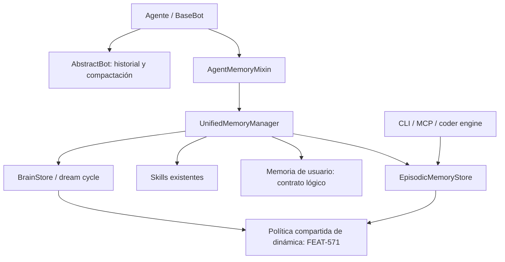

# AgentMemoryMixin: integración de memoria del agente y conocimientos del usuario

**Fecha:** 2026-11-13  
**Estado:** documento de diseño; dirección acordada, contratos detallados propuestos.  
**Base de revisión:** checkout `ca5d8e53c0`; conversación con el propietario y artefactos locales de FEAT-571.  
**Alcance:** documentar decisiones y conciliar el diseño con Agent Memory Dynamics. No constituye una especificación aprobada, una aceptación de gates ni una implementación.

## 1. Objetivo y decisiones de la conversación

El destino arquitectónico es `AgentMemoryMixin`: un único punto de integración de la memoria persistente con el ciclo de vida del agente. Debe coordinar memoria episódica, conocimientos del usuario y las capacidades existentes de largo plazo, delegando en componentes especializados.

| Tema | Dirección acordada o estado |
|---|---|
| Unificación | `AgentMemoryMixin` es la dirección esperada para sustituir `EpisodicMemoryMixin` y `LongTermMemoryMixin`. |
| Migración | El propietario autoriza un **hard-cut**, sin adaptadores temporales de los dos mixins. Actualmente no hay agentes que utilicen ambos conjuntamente. |
| Memoria de usuario | Incorporar una capacidad explícita para recordar conocimientos sobre el usuario entre conversaciones. |
| Activación | Modelarla mediante `enable_user_memory`, independiente de `enable_episodic_memory`. |
| Significado de usuario | Conocimientos sobre la persona con la que habla el agente; no datos sobre la identidad del propio agente. |
| FEAT-571 | Revisar y conciliar sus decisiones manteniendo `AgentMemoryMixin` como destino. |
| Detalles propuestos | El backend de usuario, los modelos exactos, las políticas de inferencia y las firmas de API de este documento requieren formalización. |

La semántica recomendada en la conversación para `enable_user_memory` es controlar aprendizaje y recuperación automática. Desactivarla no borra los conocimientos; olvidar es una operación explícita. Los detalles de operaciones administrativas permanecen por definir.

## 2. Problema actual verificado

[`BaseBot.ask()`](../../packages/ai-parrot/src/parrot/bots/base.py) ejecuta dos caminos independientes:

1. `LongTermMemoryMixin.get_memory_context()` recupera contexto del manager unificado.
2. `EpisodicMemoryMixin._on_pre_ask()` construye contexto episódico adicional.
3. `ask()` concatena ambos textos.

Después de la respuesta también se programan `_post_response_memory_hook()` y `_on_post_ask()` por separado. Si ambos mixins están activos y configurados, pueden duplicarse avisos y registros. La coincidencia exacta depende de los datos recuperados y de los filtros de registro; no es un duplicado garantizado en todas las peticiones.

Los mixins no son funcionalmente equivalentes. El episódico aporta preferencias, contexto de sala, registro de herramientas, toolkit y opciones de persistencia/reflexión. El unificado incorpora ensamblado presupuestado, skills y brain/dream cycle. Un cambio de nombre por sí solo perdería capacidades.

Referencias de implementación:

- [Mixin episódico](../../packages/ai-parrot/src/parrot/memory/episodic/mixin.py).
- [Mixin de largo plazo](../../packages/ai-parrot/src/parrot/memory/unified/mixin.py).
- [Manager unificado](../../packages/ai-parrot/src/parrot/memory/unified/manager.py).
- [Modelos de contexto y configuración](../../packages/ai-parrot/src/parrot/memory/unified/models.py).

## 3. Clases de memoria y propiedad

| Memoria | Ejemplo | Propietario propuesto |
|---|---|---|
| Conversacional | Los turnos anteriores de esta conversación | `AbstractBot` y el almacenamiento conversacional existente |
| Episódica | Una herramienta falló y una corrección permitió continuar | `EpisodicMemoryStore` |
| De usuario | Prefiere Python; un proyecto concreto no admite Docker | Capacidad lógica `UserMemoryStore`, pendiente de resolver su almacenamiento |
| Conocimiento consolidado | Una lección general derivada de experiencias | `BrainStore` y dream cycle |
| Skills | Procedimientos aplicables a una tarea | Registro de skills existente |

La memoria episódica es una forma de memoria de largo plazo. La memoria de usuario es conocimiento semántico sobre una persona: puede tener un episodio como evidencia, pero debe poder existir sin activar el registro episódico.

El historial sigue teniendo un único escritor en `AbstractBot`, incluida su compactación. El nuevo mixin no debe volver a guardar turnos ni reinyectar automáticamente el mismo historial como otro bloque de memoria. Debe revisarse la recuperación conversacional actual del manager para evitar esa redundancia.

## 4. Arquitectura propuesta



### Responsabilidades

- **`AgentMemoryMixin`:** configuración, conexión a hooks, contexto de petición, registro de herramientas de memoria y cierre de recursos propios. Debe ser una fachada pequeña.
- **`UnifiedMemoryManager`:** recuperación y ensamblado coordinados, enrutamiento de eventos y presupuesto común. Se reutiliza el componente existente.
- **Stores:** persistencia, identidad, filtros de ámbito, idempotencia y operaciones de dominio. FEAT-571 sitúa la aplicación de reviews en los stores, no en el mixin.
- **Políticas puras:** extracción/validación cuando corresponda, resolución de contradicciones y dinámica de memoria con responsabilidades separadas.

Debe haber un único store episódico compartido por recuperación, herramientas, registro y consolidación. Los consumidores fuera del proceso Python deben poder usar el mismo contrato sin heredar `AgentMemoryMixin`.

`UserMemoryStore` designa aquí una interfaz lógica. No decide que sea una base de datos nueva ni un servicio independiente. Puede implementarse sobre almacenamiento existente si este satisface actualización, aislamiento, trazabilidad y concurrencia.

## 5. Configuración y flags

Ejemplo conceptual; `AgentMemoryMixin` todavía no es una API implementada:

```python
class MyAgent(AgentMemoryMixin, Agent):
    enable_user_memory = True
    enable_episodic_memory = True
```

| Usuario | Episódica | Comportamiento esperado |
|---|---|---|
| Desactivada | Desactivada | Sin aprendizaje ni recuperación automática de estas dos capacidades |
| Activada | Desactivada | Conocimientos del usuario persistentes, sin exigir episodios |
| Desactivada | Activada | Experiencias del agente, sin mantener un perfil de conocimientos del usuario |
| Activada | Activada | Ambas capacidades; un episodio puede ser evidencia de un conocimiento |

Recomendaciones pendientes de formalizar:

- Usar un `AgentMemoryConfig` Pydantic v2 como configuración normalizada; resolver atributos/kwargs una vez al configurar.
- Mantener las capacidades opt-in y evitar que una flag active implícitamente otra.
- Preservar controles útiles de backend, reflexión, registro, avisos, límites y presupuesto; decidir expresamente qué sustituye a `enable_long_term_memory`.
- Conservar la configuración de skills y brain, definiendo sus dependencias. Una configuración de brain que requiera episodios debe validarse de forma visible.
- `memory_dynamics`, previsto por FEAT-571, controla las reviews y retención dinámica. No equivale a `enable_user_memory` ni habilita por sí mismo conocimientos personales.
- El default-on de dynamics sigue condicionado por los gates de FEAT-571; este documento no lo activa.

## 6. Modelo propuesto para conocimientos del usuario

Una colección de registros estructurados permite corregir y recuperar conocimientos individualmente. Un resumen libre sobrescrito en cada turno no ofrece suficiente trazabilidad.

### `UserKnowledge`

Modelo conceptual para una futura implementación Pydantic v2:

| Campo | Semántica |
|---|---|
| `knowledge_id` | Identificador estable del conocimiento |
| `tenant_id`, `agent_id`, `user_id` | Propietario y aislamiento obligatorio |
| `kind` | Hecho, preferencia, objetivo o restricción |
| `key` | Clave normalizada cuando aplique, como `preferred_language` |
| `value` | Valor estructurado o texto validado |
| `context_scope` | Ámbito de aplicación, como global o un proyecto concreto |
| `source_type` | Declaración explícita o inferencia |
| `evidence_refs` | Referencias a mensajes, turnos o episodios; no exige episodio |
| `status` | Vigente, pendiente de confirmar, sustituido o invalidado |
| `created_at`, `updated_at`, `last_confirmed_at` | Tiempos UTC de registro y confirmación |
| `valid_from`, `expires_at` | Vigencia cuando exista información temporal |
| `revision`, `supersedes_id` | Control de concurrencia y relación de sustitución |

Esta propuesta no introduce por sí sola un sistema bitemporal completo. Tener timestamps de procedencia y vigencia no resuelve todas las consultas históricas de un perfil bitemporal.

### Identidad y ámbito

El aislamiento recomendado es `(tenant_id, agent_id, user_id)`. La sesión es procedencia, no la identidad persistente del conocimiento. La identidad debe venir del contexto confiable del runtime; el LLM no elige el usuario o tenant al que escribe.

Sin identidad de usuario fiable, no registrar un perfil persistente bajo una identidad compartida como `unknown`. Compartir conocimientos entre agentes requiere una política explícita. Los atributos del usuario no deben fragmentarse por modelo LLM por defecto: el ámbito de modelo que propone FEAT-571 para experiencias de ejecución tiene otra finalidad.

### Aprendizaje, corrección y recuperación

1. Extraer candidatos a conocimiento de la interacción; las llamadas LLM deben pasar por `AbstractClient`.
2. Conservar procedencia, alcance y carácter explícito o inferido.
3. Validar si corresponde persistirlos; una expresión temporal no se convierte en preferencia permanente.
4. Comparar contra conocimientos vigentes del mismo ámbito. Una corrección explícita prevalece sobre una inferencia anterior; una contradicción ambigua no se resuelve inventando certeza.
5. Aplicar una actualización idempotente y versionada, con evidencia de la sustitución.
6. Recuperar solo conocimientos vigentes y relevantes para la petición, dentro del presupuesto común.

Ejemplos:

- «Prefiero Python» puede crear una preferencia incluso con episodios desactivados.
- «Hoy tengo poco tiempo» tiene alcance temporal; no implica una preferencia permanente por respuestas cortas.
- «En este proyecto usamos Rust» no sustituye automáticamente una preferencia global por Python.

La extracción y la persistencia de un conocimiento no equivalen a una review FSRS. Que el agente haya usado una preferencia no demuestra que sea verdadera ni refuerza automáticamente su validez.

### Operaciones de dominio propuestas

`recall`, `list`, `upsert`, `correct` y `forget`, todas con ámbito validado y resultados explícitos. Las firmas, la exposición mediante toolkit y el backend se decidirán en la especificación.

Desactivar la flag suspende el uso automático; no elimina datos. El olvido solicitado por el usuario debe definir qué ocurre con evidencias y derivados para evitar reaprender automáticamente lo olvidado. No debe confundirse con el olvido recuperable de lecciones de FEAT-571.

## 7. Ciclo de vida y contratos contra duplicados

### Configuración

Construir el manager y sus subsistemas habilitados una vez. Configurar debe ser idempotente: no repetir registro de herramientas, apertura de stores o arranque de schedulers. Preservar opciones existentes mediante una matriz explícita de equivalencias.

### Antes de la llamada LLM

1. Resolver un contexto inmutable por petición: tenant, agente, usuario, sesión, sala y ejecución.
2. Recuperar candidatos de los subsistemas habilitados.
3. Deduplicar por identidad/versiones y ensamblar bajo un presupuesto común.
4. Inyectar una sola contribución de memoria al prompt.
5. Cuando se integre FEAT-571, emitir `MemoryExposure` únicamente para las referencias que sobreviven al empaquetado final; lo descartado no puede recibir crédito.

Se recomienda conservar una API de texto como comodidad, respaldada por un resultado estructurado con referencias y procedencia. La elección del hook exacto debe formalizarse: `ask()` no debe ejecutar dos rutas de recuperación para la misma memoria. Los hooks de otras capacidades deben seguir componiéndose correctamente.

### Herramientas y respuesta

- La ejecución de herramienta y la respuesta conversacional son eventos distintos, cada uno con un solo propietario de registro.
- El hook final no vuelve a registrar las herramientas que ya registró el runtime.
- La extracción de conocimientos del usuario tiene una identidad de evento propia y no crea episodios implícitamente.
- Los reintentos deben conservar identidad para evitar escrituras duplicadas.
- Una respuesta completada sin resultado verificado no se etiqueta automáticamente como éxito. Mantener la reparación M0 de FEAT-571: episodio conversacional `QUERY_RESOLUTION/PARTIAL`, sin review.
- Las tareas asíncronas de persistencia deben tener propietario, seguimiento y cierre; no basta con lanzarlas y perderlas en shutdown.

### Reviews y cierre

FEAT-571 exige exposición efectiva, atribución y resultado verificado para una review. La recuperación por sí sola no refuerza recuerdos. El store aplica la transición durable e idempotente; el mixin transmite evidencia, no inventa grades.

El cierre debe detener schedulers y esperar escrituras propias o dejar registros durables recuperables según el contrato de almacenamiento. Un fallo de recuperación opcional puede degradar el contexto; un fallo de persistencia no debe comunicarse como escritura aplicada.

## 8. Revisión de FEAT-571

### Estado real de descomposición

La [especificación de Agent Memory Dynamics](../specs/memory-dynamics.spec.md) está aprobada para Lane 0. El [índice](../tasks/index/memory-dynamics.json) contiene cinco tareas marcadas `done` y `verified`:

| Tarea | Entrega |
|---|---|
| TASK-3382 | S1: paridad FSRS y calibración |
| TASK-3383 | S2: almacenamiento concurrente |
| TASK-3384 | S3: precisión de atribución |
| TASK-3385 | S4: estado/versionado de brain |
| TASK-3386 | M0: reparación del registro unificado |

**La descomposición es parcial:** M1–M6 se aplazan expresamente hasta revisar e incorporar las enmiendas. El `completed_at` del índice no demuestra que toda FEAT-571 esté implementada. La reparación M0 sí se observa en el manager actual; las enmiendas consultadas siguen rotuladas `PROPOSED`.

### Evidencia de gates que no debe tratarse como aprobación

| Gate | Evidencia y límite que afecta al diseño |
|---|---|
| [S1](../state/FEAT-571/spikes/s1-fsrs-parity/amendment.md) | Paridad reportada para `days-v1`; objetivos de olvido útil y persistencia obsoleta siguen pendientes. Parámetros y umbrales recomendados no quedan aceptados aquí. |
| [S2](../state/FEAT-571/spikes/s2-concurrent-storage/amendment.md) | SQLite/WAL reporta cero escrituras perdidas; la búsqueda vectorial del prototipo incumple p95 <50 ms a 5k. Propone transacciones atómicas y limita FAISS a un escritor; no seleccionamos backend definitivo. |
| [S3](../state/FEAT-571/spikes/s3-attribution/amendment.md) | Recomienda citas explícitas; corpus de 50 casos completamente sintéticos y objetivos U1/U3 pendientes. No prueba precisión en tráfico real. |
| [S4](../state/FEAT-571/spikes/s4-brain-state/amendment.md) | Propone frontmatter y versiones de contenido; la aplicación atómica de reviews requiere coordinación con S2. No se aprueba automáticamente por pasar el prototipo. |

Además, el texto de la enmienda S2 y sus reportes/métricas reflejan cifras distintas sobre pérdidas y corrupción FAISS. Ambos evidencian problemas concurrentes, pero antes de aceptar el gate debe fijarse la ejecución y evidencia canónica. Este documento no repite esas cifras como un único resultado verificado.

### Contratos que conservar

- Store como contrato para agentes Python, CLI, MCP y coder engine.
- Política compartida de dinámica para episodios, brain y feedback; no duplicarla en el mixin.
- Reviews basadas en exposición final, atribución y resultados verificables.
- Lectura sin refuerzo; ausencia de evidencia sin grade; replay e idempotencia durables.
- Identidad, namespace y versión de contenido preservados durante consolidación y atribución.
- Historial y compactación fuera del alcance de la refactorización de memoria persistente.
- Compatibilidad de datos históricos y de contratos públicos CLI/MCP separada del hard-cut de clases Python.

### Decisiones que deben conciliarse

| Punto de FEAT-571 | Cambio requerido para el nuevo diseño |
|---|---|
| §1 excluye un cuarto subsistema y un perfil bitemporal; §8 U6 deja pendiente si `USER_PREFERENCE` es suficiente | Reabrir U6. Incorporar conocimiento explícito de usuario como nueva dirección; decidir si vive sobre episodios o en un almacenamiento especializado. No declarar un perfil bitemporal completo aprobado. |
| M3 modifica ambos mixins y pide evitar doble grade | Sustituir esas integraciones por `AgentMemoryMixin` y una ruta única de registro/atribución. |
| M4 configura brain en el mixin de largo plazo | Trasladar el cableado al nuevo mixin sin mover la política de dinámica fuera de los stores. |
| M3 preserva `get_memory_context(...) -> str` | Mantener, si resulta útil, la API de texto con una representación estructurada interna; eliminar el segundo camino de inyección. |
| Compatibilidad de herramientas, feedback e históricos | El hard-cut acordado se limita a mixins/consumidores y su configuración; no autoriza borrar históricos ni retirar contratos CLI/MCP. |
| Olvido recuperable FSRS | Separarlo de caducidad/corrección de hechos y de una solicitud explícita de borrado de conocimientos del usuario. |

**Recomendación de organización:** mantener FEAT-571 como dinámica de memoria y documentar la fachada/perfil como una iniciativa coordinada. Enmendar sus puntos M3/M4 para que el destino sea `AgentMemoryMixin`, evitando dos implementaciones en competencia. Decidir en la especificación si se entrega como feature separada o ampliación; este documento no reserva IDs ni modifica tareas.

La integración básica y la memoria de usuario pueden diseñarse sin dar por aprobados FSRS o sus backends. Las partes que dependen de reviews, almacenamiento atómico o brain dinámico conservan los gates de FEAT-571.

## 9. Migración hard-cut

1. Inventariar agentes que usan cada mixin por separado, imports, exports, configuración y herramientas registradas. No tener consumidores de ambos a la vez no implica que no haya consumidores individuales.
2. Definir equivalencias de persistencia, reflexión, preferencias, contexto de sala, herramientas, skills y brain; identificar explícitamente las diferencias de namespace y rutas de datos.
3. Introducir la implementación única y actualizar consumidores, exports, ejemplos y documentación en el mismo cambio coordinado.
4. Retirar las clases y caminos antiguos, sin shims ni advertencias temporales de compatibilidad.
5. Preservar los datos existentes. Si las preferencias episódicas se convierten en conocimientos de usuario, definir una importación idempotente con procedencia, sin convertir inferencias antiguas en hechos confirmados.
6. Actualizar los contratos afectados de FEAT-571 y sus futuras tareas antes de ejecutar implementación incompatible.

El hard-cut no exige cambiar de backend ni borrar o regenerar memorias. Cualquier migración de esquema o política de eliminación necesita un contrato específico.

## 10. Validación prevista

- Matriz de las cuatro combinaciones de flags de usuario/episódica.
- Una recuperación e inyección por petición; un registro por evento incluso ante reintentos.
- Configuración repetida sin duplicar herramientas, stores o schedulers.
- Conocimientos del usuario disponibles entre sesiones y aislados entre usuarios, tenants y agentes.
- Peticiones concurrentes sin contaminación de namespaces, candidatos o manifests.
- Correcciones explícitas, conocimientos contextuales, inferencias pendientes, caducidad y conflictos concurrentes.
- Desactivar no borra; olvidar no vuelve a introducir datos desde evidencias sin aplicar la política acordada.
- Persistencia comprobada contra un store real aislado; preservar la regresión M0.
- Sin éxito ficticio, sin review por simple lectura y sin crédito a memorias eliminadas por el presupuesto.
- Cancelación, fallos de storage y cierre con tareas en vuelo.
- Contratos CLI/MCP y lectura de históricos preservados donde FEAT-571 los exige.
- Cobertura de `ask_stream()` y otras rutas de invocación: inventariar y fijar explícitamente su comportamiento, sin suponer paridad por modificar solo `ask()`.

## 11. Decisiones abiertas antes de implementar

1. Backend y representación física de conocimientos del usuario; ampliar episodios o usar una colección especializada.
2. Política de inferencia: registro automático, confirmación y tratamiento de contradicciones ambiguas.
3. Reglas de vigencia y olvido explícito, incluyendo evidencias, derivados y eventual borrado físico.
4. Compartición opcional entre agentes y límites de acceso para herramientas de memoria.
5. Firmas de configuración/hooks y equivalencias de las flags actuales, incluidos controles de skills y brain.
6. Resolución de U6 y alcance formal respecto de FEAT-571; aceptación separada de sus enmiendas S1–S4.
7. Comportamiento de streaming, invocaciones alternativas y persistencia asíncrona.

No se eligen silenciosamente valores FSRS, umbrales de atribución, backends nuevos ni dependencias. El siguiente paso es formalizar estos contratos y enmendar las secciones afectadas de FEAT-571 antes de su descomposición restante.
