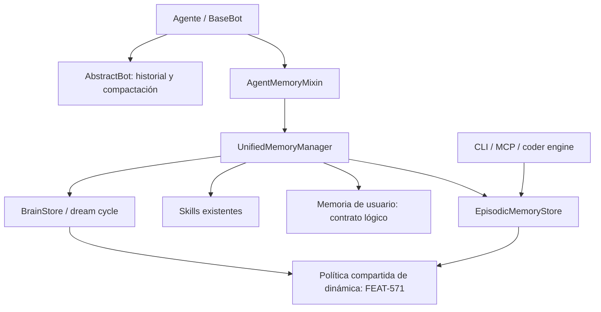

# AgentMemoryMixin: integración de memoria del agente y conocimientos del usuario

**Fecha:** 2026-11-13  
**Estado:** documento de diseño; dirección acordada, contratos detallados propuestos.  
**Base de revisión:** checkout `ca5d8e53c0`; conversación con el propietario y artefactos locales de FEAT-571.  
**Alcance:** diseñar una evolución conjunta de la integración de memoria, los conocimientos del usuario y M1–M6 de Agent Memory Dynamics, bajo un futuro spec rector. No constituye una especificación aprobada, una aceptación de gates ni una implementación.

## 1. Objetivo y decisiones de la conversación

El destino arquitectónico es `AgentMemoryMixin`: un único punto de integración de la memoria persistente con el ciclo de vida del agente. Debe coordinar memoria episódica, conocimientos del usuario y las capacidades existentes de largo plazo, delegando en componentes especializados.

| Tema | Dirección acordada o estado |
|---|---|
| Unificación | `AgentMemoryMixin` es la dirección esperada para sustituir `EpisodicMemoryMixin` y `LongTermMemoryMixin`. |
| Migración | El propietario autoriza un **hard-cut**, sin adaptadores temporales de los dos mixins. Actualmente no hay agentes que utilicen ambos conjuntamente. |
| Memoria de usuario | Incorporar una capacidad explícita para recordar conocimientos sobre el usuario entre conversaciones. |
| Activación | Modelarla mediante `enable_user_memory`, independiente de `enable_episodic_memory`. |
| Significado de usuario | Conocimientos sobre la persona con la que habla el agente; no datos sobre la identidad del propio agente. |
| FEAT-571 | Incorporar M1–M6 al futuro spec rector de la evolución conjunta, conservando contratos, resultados previos y gates pendientes. |
| Organización del trabajo | Un spec rector y un único propietario por entregable; paralelizar implementación después de fijar contratos, sin un split independiente que siga desarrollando los mixins antiguos. |
| Detalles propuestos | El backend de usuario, los modelos exactos, las políticas de inferencia y las firmas de API de este documento requieren formalización. |

La semántica recomendada en la conversación para `enable_user_memory` es controlar aprendizaje y recuperación automática. Desactivarla no borra los conocimientos; olvidar es una operación explícita. Los detalles de operaciones administrativas permanecen por definir.

## 2. Problema actual verificado

[`BaseBot.ask()`](../../packages/ai-parrot/src/parrot/bots/base.py) ejecuta dos caminos independientes:

1. `LongTermMemoryMixin.get_memory_context()` recupera contexto del manager unificado.
2. `EpisodicMemoryMixin._on_pre_ask()` construye contexto episódico adicional.
3. `ask()` concatena ambos textos.

Después de la respuesta también se programan `_post_response_memory_hook()` y `_on_post_ask()` por separado. Si ambos mixins están activos y configurados, pueden duplicarse avisos y registros. La coincidencia exacta depende de los datos recuperados y de los filtros de registro; no es un duplicado garantizado en todas las peticiones.

Los mixins no son funcionalmente equivalentes. El episódico aporta preferencias, contexto de sala, registro de herramientas, toolkit y opciones de persistencia/reflexión. El unificado incorpora ensamblado presupuestado, skills y brain/dream cycle. Un cambio de nombre por sí solo perdería capacidades.

Referencias de implementación:

- [Mixin episódico](../../packages/ai-parrot/src/parrot/memory/episodic/mixin.py).
- [Mixin de largo plazo](../../packages/ai-parrot/src/parrot/memory/unified/mixin.py).
- [Manager unificado](../../packages/ai-parrot/src/parrot/memory/unified/manager.py).
- [Modelos de contexto y configuración](../../packages/ai-parrot/src/parrot/memory/unified/models.py).

## 3. Clases de memoria y propiedad

| Memoria | Ejemplo | Propietario propuesto |
|---|---|---|
| Conversacional | Los turnos anteriores de esta conversación | `AbstractBot` y el almacenamiento conversacional existente |
| Episódica | Una herramienta falló y una corrección permitió continuar | `EpisodicMemoryStore` |
| De usuario | Prefiere Python; un proyecto concreto no admite Docker | Capacidad lógica `UserMemoryStore`, pendiente de resolver su almacenamiento |
| Conocimiento consolidado | Una lección general derivada de experiencias | `BrainStore` y dream cycle |
| Skills | Procedimientos aplicables a una tarea | Registro de skills existente |

La memoria episódica es una forma de memoria de largo plazo. La memoria de usuario es conocimiento semántico sobre una persona: puede tener un episodio como evidencia, pero debe poder existir sin activar el registro episódico.

El historial sigue teniendo un único escritor en `AbstractBot`, incluida su compactación. El nuevo mixin no debe volver a guardar turnos ni reinyectar automáticamente el mismo historial como otro bloque de memoria. Debe revisarse la recuperación conversacional actual del manager para evitar esa redundancia.

## 4. Arquitectura propuesta



### Responsabilidades

- **`AgentMemoryMixin`:** configuración, conexión a hooks, contexto de petición, registro de herramientas de memoria y cierre de recursos propios. Debe ser una fachada pequeña.
- **`UnifiedMemoryManager`:** recuperación y ensamblado coordinados, enrutamiento de eventos y presupuesto común. Se reutiliza el componente existente.
- **Stores:** persistencia, identidad, filtros de ámbito, idempotencia y operaciones de dominio. FEAT-571 sitúa la aplicación de reviews en los stores, no en el mixin.
- **Políticas puras:** extracción/validación cuando corresponda, resolución de contradicciones y dinámica de memoria con responsabilidades separadas.

Debe haber un único store episódico compartido por recuperación, herramientas, registro y consolidación. Los consumidores fuera del proceso Python deben poder usar el mismo contrato sin heredar `AgentMemoryMixin`.

`UserMemoryStore` designa aquí una interfaz lógica. No decide que sea una base de datos nueva ni un servicio independiente. Puede implementarse sobre almacenamiento existente si este satisface actualización, aislamiento, trazabilidad y concurrencia.

## 5. Configuración y flags

Ejemplo conceptual; `AgentMemoryMixin` todavía no es una API implementada:

```python
class MyAgent(AgentMemoryMixin, Agent):
    enable_user_memory = True
    enable_episodic_memory = True
```

| Usuario | Episódica | Comportamiento esperado |
|---|---|---|
| Desactivada | Desactivada | Sin aprendizaje ni recuperación automática de estas dos capacidades |
| Activada | Desactivada | Conocimientos del usuario persistentes, sin exigir episodios |
| Desactivada | Activada | Experiencias del agente, sin mantener un perfil de conocimientos del usuario |
| Activada | Activada | Ambas capacidades; un episodio puede ser evidencia de un conocimiento |

Recomendaciones pendientes de formalizar:

- Usar un `AgentMemoryConfig` Pydantic v2 como configuración normalizada; resolver atributos/kwargs una vez al configurar.
- Mantener las capacidades opt-in y evitar que una flag active implícitamente otra. **Excepción decidida por el propietario (2026-11-13):** `enable_brain` implica memoria episódica, porque el brain no puede existir sin episodios; activarlo construye el store episódico sin exigir una segunda flag.
- Preservar controles útiles de backend, reflexión, registro, avisos, límites y presupuesto; decidir expresamente qué sustituye a `enable_long_term_memory`.
- Conservar la configuración de skills y brain, definiendo sus dependencias. `enable_brain` es una flag de constructor que cualquier `Agent` puede activar (`BasicAgent` hereda el mixin); el cableado se limita a construir un `BrainService` y llamar a `start()`, `stop()` y `search()`. El comportamiento del brain se especifica en [FEAT-889 `agent-brain`](../specs/agent-brain.spec.md).
- `memory_dynamics`, previsto por FEAT-571, controla las reviews y retención dinámica. No equivale a `enable_user_memory` ni habilita por sí mismo conocimientos personales.
- El default-on de dynamics sigue condicionado por los gates de FEAT-571; este documento no lo activa.

## 6. Modelo propuesto para conocimientos del usuario

Una colección de registros estructurados permite corregir y recuperar conocimientos individualmente. Un resumen libre sobrescrito en cada turno no ofrece suficiente trazabilidad.

### `UserKnowledge`

Modelo conceptual para una futura implementación Pydantic v2:

| Campo | Semántica |
|---|---|
| `knowledge_id` | Identificador estable del conocimiento |
| `tenant_id`, `agent_id`, `user_id` | Propietario y aislamiento obligatorio |
| `kind` | Hecho, preferencia, objetivo o restricción |
| `key` | Clave normalizada cuando aplique, como `preferred_language` |
| `value` | Valor estructurado o texto validado |
| `context_scope` | Ámbito de aplicación, como global o un proyecto concreto |
| `source_type` | Declaración explícita o inferencia |
| `evidence_refs` | Referencias a mensajes, turnos o episodios; no exige episodio |
| `status` | Vigente, pendiente de confirmar, sustituido o invalidado |
| `created_at`, `updated_at`, `last_confirmed_at` | Tiempos UTC de registro y confirmación |
| `valid_from`, `expires_at` | Vigencia cuando exista información temporal |
| `revision`, `supersedes_id` | Control de concurrencia y relación de sustitución |

Esta propuesta no introduce por sí sola un sistema bitemporal completo. Tener timestamps de procedencia y vigencia no resuelve todas las consultas históricas de un perfil bitemporal.

### Identidad y ámbito

El aislamiento recomendado es `(tenant_id, agent_id, user_id)`. La sesión es procedencia, no la identidad persistente del conocimiento. La identidad debe venir del contexto confiable del runtime; el LLM no elige el usuario o tenant al que escribe.

Sin identidad de usuario fiable, no registrar un perfil persistente bajo una identidad compartida como `unknown`. Compartir conocimientos entre agentes requiere una política explícita. Los atributos del usuario no deben fragmentarse por modelo LLM por defecto: el ámbito de modelo que propone FEAT-571 para experiencias de ejecución tiene otra finalidad.

### Aprendizaje, corrección y recuperación

1. Extraer candidatos a conocimiento de la interacción; las llamadas LLM deben pasar por `AbstractClient`.
2. Conservar procedencia, alcance y carácter explícito o inferido.
3. Validar si corresponde persistirlos; una expresión temporal no se convierte en preferencia permanente.
4. Comparar contra conocimientos vigentes del mismo ámbito. Una corrección explícita prevalece sobre una inferencia anterior; una contradicción ambigua no se resuelve inventando certeza.
5. Aplicar una actualización idempotente y versionada, con evidencia de la sustitución.
6. Recuperar solo conocimientos vigentes y relevantes para la petición, dentro del presupuesto común.

Ejemplos:

- «Prefiero Python» puede crear una preferencia incluso con episodios desactivados.
- «Hoy tengo poco tiempo» tiene alcance temporal; no implica una preferencia permanente por respuestas cortas.
- «En este proyecto usamos Rust» no sustituye automáticamente una preferencia global por Python.

La extracción y la persistencia de un conocimiento no equivalen a una review FSRS. Que el agente haya usado una preferencia no demuestra que sea verdadera ni refuerza automáticamente su validez.

### Operaciones de dominio propuestas

`recall`, `list`, `upsert`, `correct` y `forget`, todas con ámbito validado y resultados explícitos. Las firmas, la exposición mediante toolkit y el backend se decidirán en la especificación.

Desactivar la flag suspende el uso automático; no elimina datos. El olvido solicitado por el usuario debe definir qué ocurre con evidencias y derivados para evitar reaprender automáticamente lo olvidado. No debe confundirse con el olvido recuperable de lecciones de FEAT-571.

## 7. Ciclo de vida y contratos contra duplicados

### Configuración

Construir el manager y sus subsistemas habilitados una vez. Configurar debe ser idempotente: no repetir registro de herramientas, apertura de stores o arranque de schedulers. Preservar opciones existentes mediante una matriz explícita de equivalencias.

### Antes de la llamada LLM

1. Resolver un contexto inmutable por petición: tenant, agente, usuario, sesión, sala y ejecución.
2. Recuperar candidatos de los subsistemas habilitados.
3. Deduplicar por identidad/versiones y ensamblar bajo un presupuesto común.
4. Inyectar una sola contribución de memoria al prompt.
5. Cuando se integre FEAT-571, emitir `MemoryExposure` únicamente para las referencias que sobreviven al empaquetado final; lo descartado no puede recibir crédito.

Se recomienda conservar una API de texto como comodidad, respaldada por un resultado estructurado con referencias y procedencia. La elección del hook exacto debe formalizarse: `ask()` no debe ejecutar dos rutas de recuperación para la misma memoria. Los hooks de otras capacidades deben seguir componiéndose correctamente.

### Herramientas y respuesta

- La ejecución de herramienta y la respuesta conversacional son eventos distintos, cada uno con un solo propietario de registro.
- El hook final no vuelve a registrar las herramientas que ya registró el runtime.
- La extracción de conocimientos del usuario tiene una identidad de evento propia y no crea episodios implícitamente.
- Los reintentos deben conservar identidad para evitar escrituras duplicadas.
- Una respuesta completada sin resultado verificado no se etiqueta automáticamente como éxito. Mantener la reparación M0 de FEAT-571: episodio conversacional `QUERY_RESOLUTION/PARTIAL`, sin review.
- Las tareas asíncronas de persistencia deben tener propietario, seguimiento y cierre; no basta con lanzarlas y perderlas en shutdown.

### Reviews y cierre

FEAT-571 exige exposición efectiva, atribución y resultado verificado para una review. La recuperación por sí sola no refuerza recuerdos. El store aplica la transición durable e idempotente; el mixin transmite evidencia, no inventa grades.

El cierre debe detener schedulers y esperar escrituras propias o dejar registros durables recuperables según el contrato de almacenamiento. Un fallo de recuperación opcional puede degradar el contexto; un fallo de persistencia no debe comunicarse como escritura aplicada.

## 8. Revisión de FEAT-571

### Estado real de descomposición

La [especificación de Agent Memory Dynamics](../specs/memory-dynamics.spec.md) está aprobada para Lane 0. El [índice](../tasks/index/memory-dynamics.json) contiene cinco tareas marcadas `done` y `verified`:

| Tarea | Entrega |
|---|---|
| TASK-3382 | S1: paridad FSRS y calibración |
| TASK-3383 | S2: almacenamiento concurrente |
| TASK-3384 | S3: precisión de atribución |
| TASK-3385 | S4: estado/versionado de brain |
| TASK-3386 | M0: reparación del registro unificado |

**La descomposición es parcial:** M1–M6 se aplazan expresamente hasta revisar e incorporar las enmiendas. El `completed_at` del índice no demuestra que toda FEAT-571 esté implementada. La reparación M0 sí se observa en el manager actual; las enmiendas consultadas siguen rotuladas `PROPOSED`.

### Evidencia de gates que no debe tratarse como aprobación

| Gate | Evidencia y límite que afecta al diseño |
|---|---|
| [S1](../state/FEAT-571/spikes/s1-fsrs-parity/amendment.md) | Paridad reportada para `days-v1`; objetivos de olvido útil y persistencia obsoleta siguen pendientes. Parámetros y umbrales recomendados no quedan aceptados aquí. |
| [S2](../state/FEAT-571/spikes/s2-concurrent-storage/amendment.md) | SQLite/WAL reporta cero escrituras perdidas; la búsqueda vectorial del prototipo incumple p95 <50 ms a 5k. Propone transacciones atómicas y limita FAISS a un escritor; no seleccionamos backend definitivo. |
| [S3](../state/FEAT-571/spikes/s3-attribution/amendment.md) | Recomienda citas explícitas; corpus de 50 casos completamente sintéticos y objetivos U1/U3 pendientes. No prueba precisión en tráfico real. |
| [S4](../state/FEAT-571/spikes/s4-brain-state/amendment.md) | Propone frontmatter y versiones de contenido; la aplicación atómica de reviews requiere coordinación con S2. No se aprueba automáticamente por pasar el prototipo. |

Además, el texto de la enmienda S2 y sus reportes/métricas reflejan cifras distintas sobre pérdidas y corrupción FAISS. Ambos evidencian problemas concurrentes, pero antes de aceptar el gate debe fijarse la ejecución y evidencia canónica. Este documento no repite esas cifras como un único resultado verificado.

### Digest de enmiendas aportado por el propietario

El propietario aportó el siguiente contenido para incorporarlo al diseño conjunto. Se registran los contratos propuestos y sus límites; incorporar el digest no equivale a aceptar los gates ni a resolver las preguntas de política pendientes. Las enmiendas enlazadas arriba conservan los detalles y la procedencia de las mediciones.

#### G1 — Paridad y calibración FSRS

- **Tiempo:** fijar `days-v1`, con la semántica de días enteros del reference. Se reporta paridad exacta en 1628 pasos. `hours-v1` diverge materialmente y se propone únicamente como variante opt-in, nunca como default silencioso.
- **Parámetros:** usar los 21 valores de `DEFAULT_PARAMETERS` del reference y sus bounds, con identidad de versión; no están ajustados con datos específicos de agentes.
- **Umbrales provisionales:** `forget_threshold=0.2` como default de trabajo pendiente de uso real; `redistill_difficulty=8.0` no fue ejercitado por el spike y necesita validación en M1. La ausencia de contradicción en una traza sintética no valida estos valores.
- **Promoción propuesta:** en modo dynamics, sustituir el conteo de `org_promotion_cycles` por `retrievability() >= forget_threshold` y al menos una review no `AGAIN`, verificada y atribuida a la versión correspondiente. Un lapse aislado no causa democión automática; la política debe explicitar cuándo se reevalúa la promoción.
- **Evidencia:** paridad PASS; supervivencia a 30 días PASS; olvido útil PENDING porque la traza no ofrece suficiente dormancia de 30 días. El criterio de promoción y la utilidad de la retención requieren aceptación separada.
- **Trazabilidad de edición:** FEAT-571 §2 FSRS/Ranking/Retention y Data Models, §3 elegibilidad M1, §8 tiempo y umbrales.

#### G2 — Almacenamiento concurrente

- **Backend local propuesto:** SQLite/WAL, con cero escrituras perdidas reportadas para ocho procesos a 5k y 10k registros. FAISS queda descartado para el papel de almacenamiento concurrente de reviews; conservar la discrepancia documental sobre sus cifras hasta reconciliar las ejecuciones.
- **Aplicación atómica:** una transacción `BEGIN IMMEDIATE` agrupa deduplicación, comprobación de revisión, inserción de review, actualización de estado y commit. Resultados previstos: `applied`, `duplicate`, `stale_revision`, `pending`, `storage_unavailable`; `pending` exige una operación durable recuperable, no una tarea solo en memoria.
- **Crash/replay:** los tres puntos ensayados, `before_log`, `after_log` y `after_state`, convergen mediante rollback y replay idempotente. Esos puntos están dentro de la transacción y antes del commit; no prueban por sí solos todos los fallos posibles de entrega de acknowledgements o replicación externa.
- **Log:** en el prototipo, las filas de reviews y el estado se confirman juntos; no hace falta un cursor de log externo para esa recuperación. Cualquier log adicional JSONL/Postgres queda subordinado al commit y no actúa como una segunda autoridad de aplicación.
- **Identidad/importación:** UUID para episodios; `uuid5` con namespace permanente para feedback importado. No reutilizar inadvertidamente la constante descartable del spike. La importación debe preservar procedencia y ser idempotente.
- **Recuperación local:** FTS5 y normalización de `bm25()` a `[0,1]`. Parametrizar SQL no evita la gramática interna de FTS5: mantener el escapado y envoltura de frase de la consulta.
- **Latencia pendiente:** el coseno exhaustivo reporta aproximadamente 130–260 ms a 5k o más registros; incumple el objetivo p95 <50 ms a 5k. Hace falta decidir y medir una estrategia de candidatos/indexación o un techo operativo explícito. Oversampling por sí solo no evita recorrer todos los vectores; `sqlite-vec` u otra extensión requiere una decisión de dependencia.
- **Otros backends:** PG/Redis fueron inspeccionados a nivel de fuente; sus actualizaciones de metadata no constituyen un protocolo atómico de review. M2 debe implementar y probar transacciones/CAS apropiados antes de habilitar ese contrato.
- **Evidencia:** escrituras y crash/replay PASS; importación idempotente PASS; latencia vectorial FAIL. No interpretar el éxito de FTS como aprobación de la ruta vectorial.
- **Trazabilidad de edición:** FEAT-571 §2 Durable Storage y Data Models, §3 elegibilidad M2, §6 C5.

#### G3 — Precisión de atribución

- **Default propuesto:** `cited`; overlap solo opt-in. En 50 casos sintéticos se reportan precisión `1.000`, refuerzo falso `0.000` y atribución omitida `0.300` para citas; overlap/combined con cap ≥3 reportan precisión `0.920` y refuerzo falso `0.080`.
- **Recovery linkage:** únicamente referencias estructurales, como un commit de corrección, un check aprobado o evidencia de firmas de error antes/después. La coincidencia de texto no demuestra que se aplicó una memoria.
- **Modelos:** trasladar `MemoryExposure`, `ReviewSignal` y `MemoryCitation`, preservando ejecución/turno, referencias/versiones entregadas, digest del contexto y evidencia del resultado. El esquema completo se concilia con la enmienda; los campos del harness no pasan automáticamente a ser API de producción.
- **Adaptadores confiables:** el runtime aporta resultados explícitos y firma de error cuando corresponda; el coder engine valida la alcanzabilidad de los fix commits aportados y exige evidencia de checks relevantes. Un merge o una lista vacía de correcciones, por sí solos, no demuestran éxito. No exigir un fix commit ficticio para acreditar una ejecución correcta al primer intento.
- **Fuentes insuficientes:** defaults de `ToolInvocation.status` o de atributos `ToolResult`, lista vacía de correcciones, autoevaluación del modelo, transporte exitoso y marcador textual de exposición del coder.
- **Separación de pruebas:** el digest incluye `tool_runtime | coder_engine | synthetic` como fuentes del harness. `synthetic` debe limitarse a pruebas; nunca puede autorizar reviews de producción. La admisión requiere evidencia confiable, no solo un literal de fuente o booleano enviado por el llamante.
- **Evidencia pendiente:** U3 todavía necesita un objetivo numérico. El corpus es 100% sintético, sin trazas reales; la repetición sobre trazas verificadas es requisito antes de considerar finales U1/U3.
- **Trazabilidad de edición:** FEAT-571 §2 Review Admission y Data Models, §3 elegibilidad M1/M3, §8 overlap/U1.

#### G4 — Estado y versiones de páginas brain

- **Almacenamiento propuesto:** diseño A, bloque de estado en frontmatter dentro de `body`, excluido de búsqueda y contexto mediante `searchable_body()`. Es el único diseño del spike que conserva el estado al copiar sin modificar `copy_page_to()`; esto no prueba que otros diseños sean inviables si se adapta su copia.
- **Migración:** no requiere una columna nueva según la propuesta. Sí requiere un contrato de lectura de páginas antiguas, versionado, archivado y preservación del estado; «sin DDL» no equivale a «sin migración».
- **Identidad propuesta:** `page_id` identifica la familia; `content_version` deriva de `sha1(body_without_state | sorted(source_episode_ids))`. El spec debe fijar serialización canónica y límites de campos para que el hash sea reproducible. Cada versión ocupa una fila; las sustituidas se archivan mediante `category="archive"`.
- **Crédito:** aplicar reviews a la versión efectivamente entregada. Deduplicar aliases de esa misma versión sin transferir a contenido nuevo el éxito atribuido a contenido antiguo. El límite de recorrido de linaje propuesto es 32.
- **Promoción:** `reinforcement_counts` y `org_promotion_cycles` quedan como señales legacy de solo lectura en modo dynamics; la evidencia debe pertenecer a la versión concreta y proceder de reviews verificadas.
- **Métricas del digest:** `pages_redistilled` cuenta familias que produjeron una versión nueva; `memories_forgotten` cuenta versiones archivadas en el ciclo. Se propone corregir esta segunda semántica en el spec: separar versiones sustituidas/archivadas de recuerdos olvidados por dynamics, para poder evaluar el objetivo de G1. Los nombres definitivos quedan por fijar.
- **Evidencia:** supervivencia de estado del diseño A PASS/PASS; FTS/pack PASS; cinco redestilaciones PASS; deduplicación de forwarding PASS, dentro del alcance del prototipo.
- **Trazabilidad de edición:** FEAT-571 §2 Durable Storage para brain y Data Models, §3 elegibilidad M4, §6 C6/C7 y §8 almacenamiento brain.

### Contrato transversal pendiente: atomicidad G2–G4

Actualizar `PageState` dentro del cuerpo de una página no queda cubierto automáticamente por la transacción del backend episódico. El spec rector debe definir el estado autoritativo, su ubicación y el protocolo de actualización para cada backend admitido. Si el frontmatter es una proyección de estado transaccional, deben fijarse versión/revisión, replay y reconciliación; si es autoritativo, debe demostrarse cómo participa en la misma garantía durable que la review.

La identidad de aplicación debe incorporar namespace, tipo de memoria, versión de contenido y resultado/revisión según el contrato común. Una review sobre contenido antiguo no debe terminar aplicada a la versión nueva por resolver aliases después del empaquetado.

El archivado puede ser idempotente, pero eso no garantiza que ocurra tras un fallo. Debe existir reconciliación durable o una regla de recuperación que excluya versiones sustituidas aunque el cambio de categoría todavía no se haya materializado. Crear la nueva versión, publicar su vigencia y retirar la anterior necesita orden y recuperación definidos.

Escribir un log externo después del commit también deja una ventana de fallo: si se promete exportación/auditoría completa, hará falta replay desde el registro transaccional u otro mecanismo durable. No se debe prometer entrega completa únicamente por ordenar la escritura del log después del commit.

Estas precisiones son requisitos propuestos para formalizar M2/M4 y sus pruebas, no una selección implícita de backend ni la aceptación de G2/G4.

### Contratos que conservar

- Store como contrato para agentes Python, CLI, MCP y coder engine.
- Política compartida de dinámica para episodios, brain y feedback; no duplicarla en el mixin.
- Reviews basadas en exposición final, atribución y resultados verificables.
- Lectura sin refuerzo; ausencia de evidencia sin grade; replay e idempotencia durables.
- Identidad, namespace y versión de contenido preservados durante consolidación y atribución.
- Historial y compactación fuera del alcance de la refactorización de memoria persistente.
- Compatibilidad de datos históricos y de contratos públicos CLI/MCP separada del hard-cut de clases Python.

### Decisiones que deben conciliarse

| Punto de FEAT-571 | Cambio requerido para el nuevo diseño |
|---|---|
| §1 excluye un cuarto subsistema y un perfil bitemporal; §8 U6 deja pendiente si `USER_PREFERENCE` es suficiente | Reabrir U6. Incorporar conocimiento explícito de usuario como nueva dirección; decidir si vive sobre episodios o en un almacenamiento especializado. No declarar un perfil bitemporal completo aprobado. |
| M3 modifica ambos mixins y pide evitar doble grade | Sustituir esas integraciones por `AgentMemoryMixin` y una ruta única de registro/atribución. |
| M4 configura brain en el mixin de largo plazo | El cableado pasa al nuevo mixin a través de `BrainService`; el resto de M4 se traslada a [FEAT-889 `agent-brain`](../specs/agent-brain.spec.md). |
| M3 preserva `get_memory_context(...) -> str` | Mantener, si resulta útil, la API de texto con una representación estructurada interna; eliminar el segundo camino de inyección. |
| Compatibilidad de herramientas, feedback e históricos | El hard-cut acordado se limita a mixins/consumidores y su configuración; no autoriza borrar históricos ni retirar contratos CLI/MCP. |
| Olvido recuperable FSRS | Separarlo de caducidad/corrección de hechos y de una solicitud explícita de borrado de conocimientos del usuario. |

### Decisión: evolución conjunta bajo un spec rector

Incorporar M1–M6 como módulos del nuevo spec integral, junto con la unificación de mixins y la memoria de usuario. Esta decisión sustituye la recomendación inicial de mantener iniciativas separadas. M1–M6 son módulos pendientes de descomposición, no tareas ya implementadas que deban duplicarse.

La incorporación es de alcance y planificación: no concentra la implementación en `AgentMemoryMixin`. El mixin conecta el agente; los stores, el núcleo puro de dinámica y los adaptadores externos conservan sus responsabilidades.

| Módulo de FEAT-571 | Entregable en el spec rector | Dependencias que conservar |
|---|---|---|
| M1 — Dynamics | Modelos comunes de dinámica, FSRS, grading, ranking y protocolos puros | G1; G3 para fijar el esquema de evidencia |
| M2 — Storage/reviews | Persistencia, aislamiento, aplicación atómica, idempotencia y replay de reviews | M1, G2, G3; U4 para retención |
| M3 — Runtime attribution | `AgentMemoryMixin`, contexto estructurado, exposición final, atribución y resultados verificados | M0, M1, M2, G3; contratos comunes de contexto/eventos |
| M4 — Brain dynamics | **Trasladado a [FEAT-889 `agent-brain`](../specs/agent-brain.spec.md), fase 2 (módulos M8–M9).** Este spec conserva solo el cableado mediante el nuevo mixin | En FEAT-889: M1, G1, G2, G4 e interfaces M1/M2 fijadas |
| M5 — SDD feedback | Adaptación e importación de feedback, evidencia del coder y contratos públicos existentes | M2, M3, G2; U2/U5 |
| M6 — CLI/MCP/operación | Construcción del mismo sistema de memoria, operaciones, exportación y fitting | Interfaces M2 (este spec) y M4 (FEAT-889) fijadas; G1/U4 y aprobación de dependencia para fitting |

Las dependencias anteriores proceden de FEAT-571 y deben conciliarse al redactar el nuevo spec. La fachada básica puede entregarse antes de la atribución dinámica completa de M3 si se separan sus contratos y pruebas; esa separación no permite saltarse los gates de reviews.

El spec también incluirá los contratos comunes de identidad/configuración/eventos, la memoria de usuario, la migración hard-cut y la validación transversal. La memoria de usuario puede compartir infraestructura y trazabilidad con dynamics, pero FSRS no determina la veracidad o vigencia de hechos personales. Una preferencia explícita no se invalida únicamente porque no se haya utilizado recientemente.

### Secuencia de formalización y trazabilidad

1. Conciliar las enmiendas G1–G4: identificar contratos aceptables, ajustes necesarios y evidencia faltante. Conservar M0 como reparación previa y su regresión.
2. Redactar el spec rector con los módulos anteriores y una matriz de contratos, propietarios y dependencias. Trasladar los criterios de aceptación y preguntas pendientes de FEAT-571 con referencias explícitas.
3. Enmendar FEAT-571 para declarar que su alcance pendiente M1–M6 queda sustituido por el nuevo spec y enlazar cada módulo con su destino. Mantener G1–G4/M0 y sus artefactos históricos; no marcar el trabajo trasladado como implementado ni los gates como aceptados por el traslado.
4. Descomponer exclusivamente en el índice del nuevo spec los entregables trasladados, una vez definidos sus contratos. Las tareas dependientes de gates pendientes conservan sus bloqueos; no crear una segunda implementación de M1–M6 en FEAT-571.
5. Ejecutar por dependencias y cerrar cada entregable con su evidencia. Los cambios de contratos compartidos deben quedar coordinados en el spec rector.

Esta edición documenta la dirección; todavía no crea el nuevo spec, reserva IDs, modifica FEAT-571 ni cambia sus estados de tareas.

### Paralelismo de implementación

Tras fijar identidad, configuración e interfaces de almacenamiento, el núcleo puro de dinámica y la memoria de usuario pueden avanzar en paralelo si no comparten archivos o decisiones pendientes. La atribución de runtime espera los contratos de contexto y reviews; brain debe coordinar atomicidad/versiones con almacenamiento; SDD se integra después de esas garantías. CLI/MCP puede prepararse contra interfaces fijadas, conservando los requisitos adicionales de fitting.

El paralelismo se asignará por entregables y propiedad de archivos durante la descomposición. No se mantendrán dos specs activos con autoridad sobre el mismo comportamiento ni una línea paralela que añada funcionalidad a mixins destinados a desaparecer.

La integración básica y la memoria de usuario pueden diseñarse sin dar por aprobados FSRS o sus backends. Las partes que dependen de reviews, almacenamiento atómico o brain dinámico conservan los gates de FEAT-571.

## 9. Migración hard-cut

1. Inventariar agentes que usan cada mixin por separado, imports, exports, configuración y herramientas registradas. No tener consumidores de ambos a la vez no implica que no haya consumidores individuales.
2. Definir equivalencias de persistencia, reflexión, preferencias, contexto de sala, herramientas, skills y brain; identificar explícitamente las diferencias de namespace y rutas de datos.
3. Introducir la implementación única y actualizar consumidores, exports, ejemplos y documentación en el mismo cambio coordinado.
4. Retirar las clases y caminos antiguos, sin shims ni advertencias temporales de compatibilidad.
5. Preservar los datos existentes. Si las preferencias episódicas se convierten en conocimientos de usuario, definir una importación idempotente con procedencia, sin convertir inferencias antiguas en hechos confirmados.
6. Formalizar el traslado de M1–M6 de FEAT-571 al spec rector y actualizar sus referencias antes de ejecutar implementación incompatible; no generar tareas duplicadas bajo el índice antiguo.

El hard-cut no exige cambiar de backend ni borrar o regenerar memorias. Cualquier migración de esquema o política de eliminación necesita un contrato específico.

## 10. Validación prevista

- Matriz de las cuatro combinaciones de flags de usuario/episódica.
- Una recuperación e inyección por petición; un registro por evento incluso ante reintentos.
- Configuración repetida sin duplicar herramientas, stores o schedulers.
- Conocimientos del usuario disponibles entre sesiones y aislados entre usuarios, tenants y agentes.
- Peticiones concurrentes sin contaminación de namespaces, candidatos o manifests.
- Correcciones explícitas, conocimientos contextuales, inferencias pendientes, caducidad y conflictos concurrentes.
- Desactivar no borra; olvidar no vuelve a introducir datos desde evidencias sin aplicar la política acordada.
- Persistencia comprobada contra un store real aislado; preservar la regresión M0.
- Sin éxito ficticio, sin review por simple lectura y sin crédito a memorias eliminadas por el presupuesto.
- Rechazo de evidencia sintética en producción; evaluación de atribución con trazas reales y umbrales explícitos antes de cerrar U1/U3.
- Aplicación de review/estado brain consistente ante duplicados, cambios de versión, fallos de archivado y crash/replay; ausencia de transferencia de crédito a versiones no entregadas.
- Latencia medida sobre la ruta de recuperación elegida; métricas distintas para sustitución de versiones y olvido por dinámica.
- Cancelación, fallos de storage y cierre con tareas en vuelo.
- Contratos CLI/MCP y lectura de históricos preservados donde FEAT-571 los exige.
- Cobertura de `ask_stream()` y otras rutas de invocación: inventariar y fijar explícitamente su comportamiento, sin suponer paridad por modificar solo `ask()`.

## 11. Decisiones abiertas antes de implementar

1. Backend y representación física de conocimientos del usuario; ampliar episodios o usar una colección especializada.
2. Política de inferencia: registro automático, confirmación y tratamiento de contradicciones ambiguas.
3. Reglas de vigencia y olvido explícito, incluyendo evidencias, derivados y eventual borrado físico.
4. Compartición opcional entre agentes y límites de acceso para herramientas de memoria.
5. Firmas de configuración/hooks y equivalencias de las flags actuales, incluidos controles de skills y brain.
6. Resolución de U6 y conciliación de los contratos trasladados de FEAT-571; aceptación separada de sus enmiendas S1–S4. La incorporación de M1–M6 al spec rector ya es la dirección acordada.
7. Comportamiento de streaming, invocaciones alternativas y persistencia asíncrona.
8. Estado autoritativo de brain y atomicidad G2–G4, con reconciliación de proyecciones, archivado y logs externos si existen. La parte de brain se decide en FEAT-889 (§8 Q4); aquí permanece el protocolo de reviews de M2 del que depende.
9. Estrategia de recuperación vectorial que cierre el fallo de latencia de G2 y evidencia canónica de sus ejecuciones; cualquier nueva dependencia requiere decisión explícita.
10. Objetivos U3, evaluación con trazas reales, validación de umbrales provisionales y métricas separadas de olvido/sustitución.

No se eligen silenciosamente valores FSRS, umbrales de atribución, backends nuevos ni dependencias. El siguiente paso es redactar el spec rector, conciliar los gates y formalizar la sustitución del alcance pendiente de FEAT-571. La descomposición restante se hará en el nuevo spec, preservando la trazabilidad y los bloqueos heredados.

## 12. Enmienda 2026-11-13 — el brain se especifica en FEAT-889

Decisión del propietario: la unificación y el brain son dos specs. Este documento cubre la unificación; [FEAT-889 `agent-brain`](../specs/agent-brain.spec.md) cubre el brain y es dueño de `parrot/memory/dream/*`, del toolkit de administrador y de su política PBAC. El corte es por propiedad de ficheros.

- **M4 de FEAT-571 se traslada a FEAT-889** (fase 2, módulos M8–M9), con sus gates G1, G2 y G4. Las referencias a M4 de los §8 y §11 remiten a ese spec.
- **Orden:** FEAT-889 no se descompone ni se lanza hasta que `AgentMemoryMixin` esté en `dev`.
- **Contrato entre ambos:** el mixin construye un `BrainService` por agente y solo usa `start()`, `stop()`, `search(query, tenant_id)` y `forget_derived(tenant_id, episodes)`. No construye stores, runners ni schedulers.

Requisitos que FEAT-889 espera de este spec (su §2, «Incoming requirements»):

| # | Requisito |
|---|---|
| R1 | `enable_brain` es una flag de constructor que cualquier `Agent` puede activar. |
| R2 | `enable_brain` implica store episódico; no hace falta una segunda flag. |
| R3 | `BrainService.start()` en `configure()` y `stop()` en `shutdown()`, de forma idempotente. |
| R4 | El tenant que se pasa a `search()` y se graba en los episodios es el de la petición, resuelto por el servidor; hoy es el atributo estático de la instancia. |
| R5 | `ask_stream()` lee y graba memoria igual que `ask()`. |
| R6 | El manager unificado llama a `BrainService.search()` y no retiene `BrainStore`. |
| R7 | La operación `forget` de memoria de usuario llama a `BrainService.forget_derived()`. |
| R8 | Los episodios de herramientas y resultados se graban en la ruta unificada. Sin ellos nada es elegible: FEAT-889 excluye de la consolidación los turnos conversacionales sin resultado verificado. |
| R9 | Nada registra `BrainAdminToolkit` en el `ToolManager` del agente. Lo monta solo el handler HTTP, por petición y cuando PBAC lo permite (FEAT-889 M6). |
| R10 | El mixin expone el servicio como `self.brain_service` (`BrainService \| None`) para que el handler pueda alcanzarlo. |

Este documento tampoco menciona FEAT-886 (`durable-conversation-memory`), que tiene tareas abiertas sobre el historial conversacional; conviene comprobar el solape con el §3 antes de redactar el spec rector.
