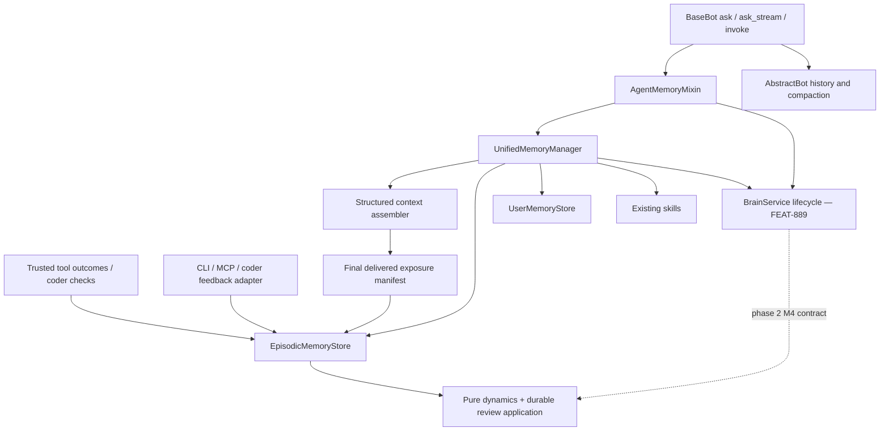

# Feature Specification: Agent Memory — Unified Integration, User Knowledge and Dynamics

**Feature ID**: FEAT-892
**Date**: 2026-11-13
**Author**: Jesus Lara, with Codex
**Status**: review
**Target version**: next release after acceptance of the applicable gates; release number unassigned

**Source:** [accepted direction and detailed design](../proposals/agent-memory-mixin.design.md), including §12 and its R1–R10 contract. Detailed policies and gate amendments remain proposed where explicitly noted. This specification incorporates pending M1/M2/M3/M5/M6 of [FEAT-571](memory-dynamics.spec.md). M4 belongs to [FEAT-889 — agent-brain](agent-brain.spec.md), phase 2 (M8–M9); this feature owns only its agent integration. Completed G1–G4/M0 work remains evidence, not an assertion that its gates passed.

## 1. Motivation & Business Requirements

### Problem Statement

The agent currently has two independent persistent-memory integration paths: `EpisodicMemoryMixin` through pre/post-ask hooks, and `LongTermMemoryMixin` through a unified manager. `BaseBot.ask()` invokes both and concatenates their contexts, with two post-response recording paths. If both are configured, warnings and episodes can duplicate. Their capabilities also differ, so a rename alone loses behavior.

Agents need durable, correctable knowledge about the user across sessions, independently of episodic recording. The outstanding FEAT-571 dynamics modules must evolve alongside the new integration rather than adding functionality to mixins scheduled for removal.

### Goals

- One `AgentMemoryMixin` integration, one owner per recording event, and one budgeted memory contribution per invocation.
- Independent `enable_user_memory` and `enable_episodic_memory`; user knowledge works without episodic storage.
- Hard-cut migration of the two old mixins and their consumers; preserve persisted data and separately governed CLI/MCP contracts.
- Give every FEAT-571 module one owner: M1/M2/M3/M5/M6 here, M4 in FEAT-889, with explicit integration contracts and no duplicated backlog.
- Store-owned, evidence-verified dynamics accessible from Python agents, CLI, MCP and coder integrations; preserve G1–G4 gates and M0's real-store regression.
- Request-local namespaces, durable idempotency, version-aware attribution, correction and explicit forgetting of user knowledge.

### Non-Goals

- Moving history ownership or compaction out of `AbstractBot`; changing provider client base classes.
- Placing FSRS, persistence engines or coder adapters inside the mixin.
- Implementing brain stores, scheduling, redistillation, promotion or administrative HTTP/PBAC; FEAT-889 owns `memory/dream/*` and that administration surface.
- Treating FSRS retrievability as truth/confidence of user facts, or requiring episodes for user knowledge.
- A complete bitemporal profile plane, cross-agent profile sharing by default, autonomous rehearsal probes, or skill usefulness scoring.
- Automatically accepting synthetic benchmarks, selecting unapproved dependencies, deleting historical data, or retiring public feedback/MCP contracts through the mixin hard-cut.

## Governing Decisions

<!-- decision-audit: input_digest=sha256:0f8975d902c9881add322cb722df1870cacdbafac5122ef8ffc0032917739269 evaluation_digest=sha256:a0423d26ca4f96608ef85b8dca5a79aebbf5921bd7a22bd0768602ef983faab6 rules_version=1 status=pass -->

## 2. Architectural Design

### Overview and authority

This governs the agent integration and M1/M2/M3/M5/M6. Source §12 supersedes the earlier all-in-one M1–M6 proposal: FEAT-889 exclusively owns M4 and `memory/dream/*`. A0/A1/U1/X1 supply common contracts, integration, user knowledge and migration. Completed TASK-3382–3386 remain historical evidence and are not recreated. The companion FEAT-571 scope-transfer amendment is an explicit X1 deliverable before downstream implementation is released; until then, this review-status document does not silently change its approved scope or task index.

`AgentMemoryMixin` is a lifecycle adapter around `UnifiedMemoryManager`, not a storage or FSRS engine. Stores own validation and durable mutations. CLI/MCP/coder consumers use the same stores without inheriting the mixin. Preserve the existing `parrot.memory.agent` module (`AgentMemory = AnswerMemory`); the new package is `parrot.memory.agent_memory`.

### Component Diagram



### Integration Points

| Existing component | Integration | Contract |
|---|---|---|
| BaseBot | One preparation/finalization path for persistent memory in ask, stream and invoke | C1; do not double-call through low-level conversation |
| AbstractBot | Existing configure guards, trusted request scope and history ownership | C2; no provider-client changes |
| UnifiedMemoryManager/ContextAssembler | Structured candidates, one budget, user knowledge and final exposure | C3/C4 |
| Episodic store/backends/cache | Scoped identities, durable events/reviews, lexical fallback, full-scope retrieval | C5–C8 |
| ToolManager | Request-local capture at execution boundary, alongside existing task observer | C9; never replace its observer or infer domain success from defaults |
| BrainService (FEAT-889) | One instance per agent; lifecycle, tenant-bound search and derived forgetting | Source §12 R1–R10; C10/C11 describe existing internals, read only here |
| Coder feedback/reviews/engine | Stable adapters and IDs, engine-owned exposure and verified check evidence | C12–C14 |
| MCP factory and AbstractToolkit | New self-contained toolkit with lazy `_open`/`_close`; explicit YAML section | C15; no new implicit built-in registry |
| FEAT-887 experience.pitfall | Separate operational lessons; preserve its approved interfaces and shared-file edits | Not absorbed by this feature; no automatic conversion into trusted FSRS evidence |
| FEAT-886 durable conversation memory | Preserve hydration, turn publication, compaction and partial-stream saves | Shared BaseBot attachment sites require sequencing; no history ownership transfer |

### Configuration and scope

New Pydantic v2 `AgentMemoryConfig` normalizes constructor kwargs over subclass attributes over defaults. This precedence is part of the proposed contract. No per-request mutation of instance configuration. `enable_user_memory=False` and `enable_episodic_memory=False` are independent opt-ins. `enable_brain=False` is available on every Agent through BasicAgent inheritance; when true it implies an effective episodic store, without a second flag (R1/R2). It never enables user knowledge. Skills retain an explicit setting. `memory_dynamics` remains disabled until its accepted policy/backend is configured; the FEAT-571 default-on rollout is still conditional, not assumed by this spec.

The matrix below assumes `enable_brain=False`; with brain enabled, effective episodic enablement is `enable_episodic_memory or enable_brain`.

| User | Episodic | Required behavior |
|---|---|---|
| off | off | No automatic profile/episode reads or writes; history remains unchanged |
| on | off | Learn/retrieve/correct user knowledge without constructing an episodic store |
| off | on | Episodes and lessons; no automatic user-profile injection or extraction |
| on | on | Both, with optional evidence links; one writer per event |

Disabling user memory stops automatic learning and recall, not deletion. Explicit administrative list/correct/forget remains available through an authorized service API; LLM tools bind scope from runtime and cannot select another principal. No automatic profile for a missing/anonymous identity: distinguish caller-supplied identity from BaseBot's `anonymous` fallback. A shared room alone does not identify its speaker.

Preserve episodic backend/DSN/schema/path, reflection control, warning limits, trivial-tool suppression, and explicit flush behavior through a migration mapping. Resolve persisted paths before opening stores; do not turn startup into an implicit flush. Document brain's implied episodic storage explicitly. Skill injection and tool exposure remain distinct settings. Remove `enable_long_term_memory` with the old mixins; document its explicit per-capability replacement rather than retaining a compatibility switch.

### Brain integration boundary — source §12 R1–R10

The mixin exposes `self.brain_service: BrainService | None`, constructs at most one service per agent with the effective episodic store, and calls idempotent `start()` after configuration and `stop()` before resource shutdown. The manager receives this service and calls `search(query, tenant_id, max_tokens)` with the server-resolved request tenant; it holds no `BrainStore`. Both ask and streaming use the same tenant for recall and episode recording. User forgetting routes affected episodes through `forget_derived(tenant_id, episodes)` and retains retry state until derivative invalidation succeeds. The service owns consolidation eligibility; unverified conversational PARTIAL episodes are not brain evidence.

Never register `BrainAdminToolkit` on the agent's ToolManager. FEAT-889 M6 mounts it only on the HTTP handler's per-request ToolManager after its PBAC check; `self.brain_service` is the public access point. No HTTP handler or administrative toolkit implementation is owned here. The integration calls only `start`, `stop`, `search` and `forget_derived`; it never builds a store, runner or scheduler directly.

FEAT-892 lands on dev before FEAT-889 is decomposed or launched. To avoid a circular implementation dependency, brain construction is lazy and its contract tests inject a fake matching the sibling's proposed service interface. Until FEAT-889 supplies the concrete service, disabled brain imports no missing module; enabling an unavailable concrete service reports `invalid_configuration`, never silently uses the old store/runner path. Full brain operation and M4 acceptance belong to the later sibling release. This staging behavior is explicit, not a claim that the new BrainService already exists.

`MemoryRequestScope` is immutable and runtime-bound: tenant, agent, optional user/session/room/crew/model, turn/execution ID and identity provenance. Episode filters may narrow by session; user knowledge identity is `(tenant_id, agent_id, user_id)` across sessions and independent of model. Apply scope before top-k, in fallback retrieval and caches. Cross-agent episodic sharing keeps explicit routing policy; user knowledge is excluded from that routing and org-brain promotion by default.

### Data Models — proposed contracts, not existing imports

All new structured models use Pydantic v2, aware UTC times, finite numeric validation and `extra="forbid"` for commands. No model-generated grade or `verified=True` flag constitutes authority. Model schemas below are normative targets; fields with an unresolved gate cannot be implemented until that gate is amended into this spec.

| Model / location | Required content and invariants |
|---|---|
| `AgentMemoryConfig`, `MemoryRequestScope` — `agent_memory/models.py` | Capability flags, common context budget, backend policies; immutable trusted invocation dimensions and identity provenance. No DSN literals; secrets resolve from environment. |
| `MemoryEvent` — `agent_memory/models.py` | Event ID, kind (`tool`, `response`, `user_knowledge`), scope, observed time, evidence references and bounded payload. Same event retry preserves ID; distinct tool attempts and final response remain distinct events. |
| `MemoryWriteReceipt` — `agent_memory/models.py` | Event identity/scope, durable status and resulting episode/knowledge/review references. Recording an episode does not fabricate a dynamics review; constituent failures remain explicit. |
| `MemoryCandidate` — `unified/models.py` | Typed scoped reference, content version, text, source, normalized relevance, separate ranking score and provenance. User candidates do not carry an FSRS grade. |
| `MemoryContext` additions — `unified/models.py` | User knowledge section, ordered delivered refs, packed digest/exposure metadata and existing strings/token counters. Legacy text API remains. |
| `UserKnowledge` — `user/models.py` | Stable ID; tenant/agent/user; kind (`fact`, `preference`, `goal`, `constraint`); optional normalized key; validated value; context scope; explicit/inferred provenance; evidence refs; status (`active`, `pending`, `superseded`, `invalidated`); created/updated/confirmed/valid-from/expiry timestamps; revision and supersedes ID. Session is evidence, not identity. |
| `UserKnowledgeCandidate`, `UserKnowledgeCommand` — `user/models.py` | Extracted bounded claim/evidence/context and a validated operation/event identity with expected revision. Never let extraction choose the trusted principal. |
| `UserMemoryReceipt` — `user/models.py` | Knowledge ID/revision and `applied`, `duplicate`, `conflict`, `ignored` or `storage_unavailable`; no successful acknowledgement before durable application. Forget must prevent automatic resurrection from retained evidence. Physical erasure policy is Q2. |
| `Grade`, `MemoryState`, `MemoryParameters` — `dynamics/models.py` | AGAIN=1/HARD=2/GOOD=3/EASY=4; state difficulty/stability/retrievability inputs, timestamps/counts/status/apply revision; immutable algorithm/time-policy/parameter identity, 21 validated parameters and fitting provenance. Legacy uninitialized state is neutral, not an earned review. |
| `MemoryRef` — `dynamics/models.py` | Full namespace, kind (`episode`, `brain`), stable ID, content version; a bare page ID is not unique across stores. |
| `MemoryExposure`, `MemoryCitation` — `dynamics/models.py` | Runtime-minted exposure/turn/attempt identity, ordered actually delivered refs and packed digest; citation is a subset of that exposure, not a grade. |
| `ReviewSignal` — `dynamics/models.py` | Immutable outcome ID/revision, evidence reference, observed time, scope, trusted source, outcome, first-attempt/correction information and structural recovery references. Production sources exclude `synthetic`. |
| `ReviewRecord`, `ReviewReceipt`, `ReviewCommand` — `dynamics/models.py` | Delivered target/version, outcome identity, attribution/grade or no-review reason, before/after state, parameter identity, expected/apply revisions; scoped durable dedupe. `applied` means committed; `pending` requires durable replay. |
| `CheckedPattern` — `dynamics/models.py` | Pattern, delivered memory ref/version, exposure ID, application claim and evidence references. Untrusted until engine verification. `DevelopmentOutput.checked_patterns` defaults empty. |
| `EpisodeSearchResult` additions | Keep `score` as bounded similarity; add `ranking_score`, retrievability, stability and review count separately. |

`MemoryNamespace` and episode serialization gain optional `model_id` for execution/coder lessons, preserving existing dimensions. Encoding, SQL/cache migration and permanent UUID import namespace are frozen by G2 acceptance, not inferred from the prototype constant.

### Lifecycle and invocation contract

1. **Configure:** cooperative `AgentMemoryMixin.configure(app=None)` awaits host configuration, respects `configure_skipped`, then configures only enabled stores. Repeated configure must not duplicate tools/schedulers; genuine app reconfiguration must not skip necessary rebinding. Partial initialization releases acquired resources.
2. **Prepare:** BaseBot passes a runtime-derived `MemoryRequestScope` to one `prepare_memory` call. The manager retrieves typed candidates concurrently and assembles one block. Memory content is contextual data, never higher-priority instructions. Profile identity is resolved before anonymous defaults erase that distinction.
3. **Deliver:** commit an exposure only for memory blocks actually supplied to the model after final packing. Drop whole versioned blocks when necessary or identify delivered fragments explicitly; never credit a full candidate that was trimmed away. Record cancellation/provider failure separately from a completed response.
4. **Observe tools:** capture actual executed attempts at ToolManager's boundary. Preserve the FEAT-538 invocation observer and guard/cancellation semantics. New memory capture uses a request-local ContextVar, not a second global instance observer. Tool-call return alone proves execution, not task success; G3 binds trusted checks and recovery evidence.
5. **Finalize:** record one PARTIAL query-resolution episode when no outcome is verified, preserving M0. Do not replay tool calls as extra episodes. User extraction runs independently when enabled, using `AbstractClient` for any LLM extraction. Record only bounded validated candidates under the policy accepted in Q1.
6. **Cleanup:** stop schedulers and drain owned writes before closing LLM/storage dependencies. Preserve cancellations. Acknowledged writes survive shutdown; unacknowledged background work is not claimed durable. Closed/failed memory operations expose stable status, not swallowed success.

`ask()`, `ask_stream()` and `invoke()` must follow the same integration contract. Streaming finalizes once on a completed response, not per chunk; cancellation produces no fabricated final success or profile update from partial assistant output. The low-level `conversation()` path must not repeat a memory lifecycle already owned by its caller; its direct-call behavior is documented and tested as an explicit low-level boundary. Existing generic pre/post hooks remain composable for non-memory mixins, but no longer carry a second persistent-memory implementation.

History continues through `AbstractBot.save_conversation_turn` and provider-neutral rendering. Preserve FEAT-886 hydration guards, raw-turn publication, compaction and partial-stream history saves; an interrupted turn can be saved as history without becoming a successful memory review or user-knowledge update. The new agent integration disables unified conversation-summary retrieval to prevent injecting the same history twice. Keep standalone manager text/history compatibility for existing explicit callers; the agent path owns only supplementary persistent memory.

### User knowledge semantics

Explicit statements, inferred claims and task outcomes are different evidence classes. An explicit correction outranks an earlier inference in the same context. A project-specific constraint does not overwrite a global preference. Ambiguous contradictions remain pending/conflicted; no last-writer-wins assertion of truth. Temporal statements such as “today I have little time” cannot become permanent style preferences.

The logical `UserMemoryStore` supports recall/list/upsert/correct/forget with scoped CAS and event dedupe. Its physical backend is Q1: the implementation may reuse storage primitives, but it cannot require `enable_episodic_memory=True`. No full bitemporal plane is implied by provenance and validity timestamps. Optional future cross-agent sharing requires a policy amendment.

FSRS ranks experiential usefulness; it does not determine user-fact truth or expiry. An unused explicit preference remains valid until corrected, expired or forgotten under its own policy. Explicit forgetting is distinct from recoverable FSRS exclusion; retained messages, episodes and brain derivatives must not silently re-extract forgotten user facts. Q2 freezes suppression/erasure scope before shipping this capability.

### FEAT-571 gate carry-forward

| Gate | Carried candidate contract / reported evidence | Still blocks |
|---|---|---|
| G1/S1 | `days-v1` whole elapsed days, exact reference parity over 1628 steps; unrefit 21 parameters/bounds; `hours-v1` opt-in only | Useful-forgetting target U3, real calibration, `0.2` forget threshold and `8.0` redistill threshold validation. Parity/survival PASS is not gate acceptance. |
| G2/S2 | SQLite/WAL candidate; 8-process zero-loss at 5k/10k; atomic dedupe+revision+review+state commit; replay/import PASS | Vector p95 <50 ms at 5k FAIL (~130–260 ms reported); indexing/ceiling decision, canonical FAISS evidence, PG/Redis transaction paths and brain-state atomicity. |
| G3/S3 | Proposed default `cited`; overlap opt-in; structural recovery only; 50 synthetic cases: cited precision 1.000, missed attribution .300; overlap precision .920/false reinforcement .080 at cap ≥3 | Numeric U3 rubric and real verified traces; exact trusted evidence adapters. `synthetic` is test-only, never production evidence. |
| G4/S4 | Frontmatter candidate survives existing copy; content-version identity, delivered-version credit, bounded lineage 32; prototype copy/packing/redistill/dedupe PASS | Authoritative state and atomic G2/G4 application, migration/reconciliation, promotion policy and metric semantics. |

Use the four [gate amendments](../state/FEAT-571/spikes/) and their source reports. S2's summary and recorded runs disagree on exact FAISS loss/corruption figures; select the canonical run before acceptance. Oversampling alone does not fix exhaustive cosine cost. An ANN/vector extension needs explicit dependency acceptance. No FTS-only benchmark substitutes for the failing vector route without an explicit performance-contract amendment.

Review admission order: validate trusted scope and final exposure; validate observed outcome/evidence; validate attribution; select grade; apply durably. No outcome, cancellation, incomplete execution, irrelevant failure or missing attribution means **no review**. Same normalized nonempty error signature on verified repeated failure → AGAIN. Verified structurally linked recovery → EASY (overlap capped to GOOD). Success with confirmed corrections → HARD. Verified first-attempt success with zero corrections → GOOD. Otherwise no review. Initial/inherited state is a prior with zero earned reviews/promotion credit; it never fabricates optimizer data.

Rank experiential candidates by normalized relevance × retrievability × (1 + importance/10), with stable-ID tie breaks and anti-pattern grouping; preserve raw similarity. Apply the policy across warnings and room/legacy preference episode retrieval, not as a second post-render sort. FEAT-889 phase 2 extends it to brain through the agreed service boundary. User knowledge uses its independent relevance/validity policy. Uninitialized legacy dynamics state is neutral until valid review. Access updates bookkeeping only. Refit parameters are versioned; out-of-order outcome revisions require replay/reconciliation.

G2's local transaction is the authoritative review log and state update for its prototype. A JSONL/Postgres audit/export sink is subordinate, not a second owner of review application. Post-commit export needs durable replay/outbox if completeness is promised. Include crash-after-commit-before-ack/export tests beyond the three pre-commit prototype crash points. Imported feedback must remain replayable and must not disappear through a generic 90-day TTL sweep.

G4 is carried as an external M4 contract owned by FEAT-889: frontmatter in `body`, stripped before FTS/summary/packing, with canonical content hashing over prose and source IDs. “No new column” does not mean “no migration.” Content versions are distinct rows, family ID remains stable, and reviews credit the delivered version only. Do not transfer old success to synthesized content. Q3 is coordinated with FEAT-889's atomicity decision: if frontmatter is a projection, define authoritative transactional state, revision and replay; if authoritative, prove atomic review/state application. Idempotent archival still needs reconciliation or admission filters during failures. Its report semantics distinguish redistillation, supersession and dynamics forgetting; this feature does not redefine or implement the sibling's counters.

The sibling's phase-1 `BrainService.search` returns text, not versioned exposure candidates. Therefore this feature must not infer per-page citations or apply brain reviews from that text. A structured service-boundary extension is required before M4 dynamics are connected, frozen jointly with G1/G2/G4 and the accepted G3 evidence schema. That extension belongs to FEAT-889's phase-2 contract amendment; the current phase-1 interface is sufficient for tenant-bound recall and derivative deletion.

### Error and durability contract

Stable categories: `invalid_configuration`, `invalid_parameters`, `missing_user_identity`, `scope_mismatch`, `unverified_outcome`, `outcome_conflict`, `stale_revision`, `storage_unavailable`, `unsupported_backend`, `lineage_cycle`, `knowledge_conflict`. Unknown in-scope refs may return ignored receipts; cross-scope requests reveal no content. Duplicate valid commands return duplicate without new state transition. Reusing an outcome/event ID with conflicting payload is a conflict. Optional recall may degrade with visible status; failed writes must not appear applied or pending without durable backing.

## 3. Module Breakdown

Prefixes in module paths: `core/` = `packages/ai-parrot/src/parrot/`; `tests/` = `packages/ai-parrot/tests/`. Interface skeletons declare proposed contracts only; their docstrings contain no implementation bodies. Gate-dependent signatures/models are not released for task implementation until the listed questions are resolved.

| Module | Responsibility | Depends on |
|---|---|---|
| A0 | Common configuration, immutable scope/events, runtime binding | X1 scope transfer; Q1/Q4 for final policy schema |
| A1 | Agent facade, single lifecycle/context, hard-cut integration | A0; U1 before user feature completion; M3 for dynamics attribution |
| U1 | User knowledge models/service/storage, extraction, correction/forgetting | A0, Q1/Q2/Q4; storage gate if sharing its backend |
| M1 | Pure dynamics/models/parameters/grade/ranking | G1 and G3 acceptance |
| M2 | Episodic persistence, atomic reviews, scoped recall/cache/import | M1, G2/G3, U4 |
| M3 | Structured exposure, runtime/coder-independent evidence admission | A0/A1, M1/M2, G3; M0 already present |
| M4 (external) | FEAT-889 phase 2 M8–M9: brain versions, state, lineage, promotion and reconciliation | This feature's M1/M2 contracts; G1/G2/G4, Q3; no files owned here |
| M5 | Coder feedback migration/adapters and checked-pattern evidence | M2/M3, U2/U5; shared-file coordination with FEAT-887 |
| M6 | Lazy CLI/MCP service, operations/export (fitting deferred to a follow-up) | M2 frozen interfaces; U4 retention; brain operations deferred to FEAT-889's contract |
| X1 | Scope transfer, consumer/API migration and documentation | A0/A1 for code migration; all modules for final release |

X1's scope-transfer document amendment is an initial administrative slice, not a cyclic implementation dependency. A1's base lifecycle can precede M3; M3 adds dynamics receipts to its fixed extension points. Completion requires all locally owned modules and their gates; external M4 is not a precondition for landing FEAT-892. The A1 brain boundary must pass contract tests before the handoff to FEAT-889.

#### Delegation-eligible modules

| Module | Eligible now? | Decided contracts | Why not / release condition |
|---|---|---|---|
| A0 | no | Immutable scopes, per-event identity, independent flags | Q1/Q4 configuration and policy bounds |
| A1 | no | Single lifecycle, cooperative configure, history ownership | A0 and consumer mapping must be frozen |
| U1 | no | Scoped revisioned records and independent flag | Physical storage, extraction and erasure Q1/Q2 |
| M1 | no | Pure signatures and grade order | G1/G3 acceptance still outstanding |
| M2 | no | Scoped atomic dedupe/state, no fake durable ack | G2 latency/identity/backend contracts and U4 |
| M3 | no | Final-delivery exposure, request-local tool capture | G3 adapters/rubric and M2 interfaces |
| M4 | external | FEAT-889 exclusive ownership; delivered-version credit | Never decompose under FEAT-892; sibling waits for this feature to land |
| M5 | no | Preserve public signatures/IDs/audit | U2/U5, checked-evidence plumbing, FEAT-887 shared files |
| M6 | no | Store client, lazy toolkit lifecycle, no implicit registry | Concrete storage construction, export retention |
| X1 | yes, documentation slice only | Add FEAT-892/FEAT-889 scope mapping to FEAT-571; preserve completed tasks | Code migration waits for A1; no rewriting gate verdicts |

### A0 — Common configuration and runtime scope

Create `core/memory/agent_memory/{__init__,models,runtime}.py`. Keep model imports light and avoid forcing wiki/embeddings when disabled.

```python
# New: memory/agent_memory/runtime.py; types in sibling models.py
def bind_memory_scope(scope: MemoryRequestScope) -> Token:
    """Bind a trusted immutable request scope; return the reset token."""
def reset_memory_scope(token: Token) -> None:
    """Restore the previous scope in a finally block, including cancellation."""
def current_memory_scope() -> MemoryRequestScope | None:
    """Return the current request's memory scope, never instance-shared state."""
```

### A1 — Facade, manager and lifecycle

Create `core/memory/agent_memory/mixin.py`; modify `core/bots/{base,agent}.py`, `core/memory/unified/{manager,context,models}.py`. BasicAgent inherits AgentMemoryMixin before Chatbot so every Agent accepts the capability flags and cooperates with configure/cleanup. Preserve existing skills construction. Replace direct brain construction with the lazy BrainService boundary specified above; no agent-side admin toolkit registration. Delete old mixin files only in coordinated X1 migration, not while their consumers remain.

```python
# New: memory/agent_memory/mixin.py
class AgentMemoryMixin:
    """Integrate enabled persistent-memory capabilities with the host agent."""
    brain_service: BrainService | None
    async def configure(self, app: Any = None) -> None:
        """Cooperate with host configure; initialize once after its resources exist."""
    async def prepare_memory(self, query: str, *, scope: MemoryRequestScope) -> MemoryContext:
        """Return one scoped supplementary context; never reload conversation history."""
    async def complete_memory(self, event: MemoryEvent) -> None:
        """Route one completed invocation event; tools own separate event identities."""
    async def cleanup(self) -> None:
        """Drain owned work and stop schedulers before cooperating with host cleanup."""

# Add to UnifiedMemoryManager, verified: core/memory/unified/manager.py:53
async def prepare_context(self, query: str, *, scope: MemoryRequestScope) -> MemoryContext:
    """Retrieve enabled capabilities under the supplied scope and one common budget."""
async def record_event(self, event: MemoryEvent) -> MemoryWriteReceipt:
    """Dispatch to the owning store; return durable results without duplicating tool episodes."""
```

Retain `get_context_for_query(query, user_id, session_id) -> MemoryContext` and `record_interaction(query, response, tool_calls, user_id, session_id) -> None` as existing manager contracts, with their behavior explicitly adapted. Public text retrieval remains a formatter, not an independently executed second path. The manager's constructor replaces direct brain/org-brain store arguments with `brain_service`; document that explicit integration-API break. Store APIs themselves remain available to their owning subsystem.

### U1 — User knowledge

Create `core/memory/user/{__init__,models,store,extraction}.py`. Physical backend files are withheld until Q1 names and verifies them; a worker may not invent that choice. New data APIs below accept trusted scope separately from LLM candidates.

```python
class UserMemoryStore:
    """Manage cross-session user knowledge with scoped revisions and evidence."""
    async def recall(self, query: str, *, scope: MemoryRequestScope, limit: int = 5) -> list[UserKnowledge]:
        """Return relevant active facts for this user/context; never FSRS-grade them."""
    async def list(self, *, scope: MemoryRequestScope, limit: int = 100) -> list[UserKnowledge]:
        """List permitted knowledge with status and provenance."""
    async def upsert(self, command: UserKnowledgeCommand, *, scope: MemoryRequestScope) -> UserMemoryReceipt:
        """Apply an idempotent revision-checked candidate; preserve conflicts explicitly."""
    async def correct(self, command: UserKnowledgeCommand, *, scope: MemoryRequestScope) -> UserMemoryReceipt:
        """Supersede a scoped claim using explicit evidence and expected revision."""
    async def forget(self, command: UserKnowledgeCommand, *, scope: MemoryRequestScope) -> UserMemoryReceipt:
        """Apply the accepted erasure/suppression contract, including derivative replay."""

# New: memory/user/extraction.py
async def extract_user_knowledge(event: MemoryEvent, *, client: AbstractClient) -> list[UserKnowledgeCandidate]:
    """Propose bounded claims from user evidence; do not persist, set scope or assert truth."""
```

### M1 — Pure dynamics

Create `core/memory/dynamics/{__init__,models,fsrs,grade,ranking,review_log}.py`. `review_log.py` declares the storage protocol only; I/O remains in adapters. Carry the pinned MIT reference/license from S1 only after acceptance, not a dependency on test-only prototype code.

```python
def retrievability(state: MemoryState, *, now: datetime, parameters: MemoryParameters) -> float:
    """Return bounded retrievability under immutable time policy; legacy neutral state stays neutral."""
def transition(state: MemoryState, grade: Grade, *, reviewed_at: datetime,
               parameters: MemoryParameters) -> MemoryState:
    """Apply the pinned deterministic FSRS transition without I/O or global clock reads."""
def select_grade(signal: ReviewSignal, *, attributed: bool,
                 memory_error_signature: str | None, verified_recovery: bool) -> Grade | None:
    """Apply ordered grading to already validated evidence; missing signal returns no review."""
def rank_candidates(candidates: list[MemoryCandidate], *, now: datetime,
                    parameters: MemoryParameters) -> list[MemoryCandidate]:
    """Rank experiential candidates with normalized relevance and deterministic ties."""
class ReviewBackend(Protocol):
    """Storage capability for durable review/state application, not a second memory service."""
    async def apply_review(self, command: ReviewCommand) -> ReviewReceipt:
        """Atomically dedupe and check revision before storing review plus state."""
```

### M2 — Episodic storage, reviews and retrieval

Modify `core/memory/episodic/{models,store,recall,cache,tools}.py` and `backends/{abstract,pgvector,redis_vector,faiss}.py`. Conditional creation of `backends/sqlite.py` after G2 acceptance; chosen index/transaction details must first amend this spec. Unsupported review configuration fails visibly; baseline legacy reads remain available when dynamics is off. Add explicit-lesson text before persistence, not by mutating the returned episode.

```python
# Additions: EpisodicMemoryStore, verified: core/memory/episodic/store.py:57
async def review(self, memory_ids: list[str], signal: ReviewSignal, *,
                 namespace: MemoryNamespace, exposure_id: str) -> list[ReviewReceipt]:
    """Resolve delivered versions, validate scope/evidence and apply reviews durably once."""
async def cite(self, memory_ids: list[str], *, namespace: MemoryNamespace,
               exposure_id: str) -> MemoryCitation:
    """Bind attribution to delivered versions; never reinforce by citing alone."""
# Add to EpisodicMemoryToolkit, verified: core/memory/episodic/tools.py:22
async def cite_memory(self, episode_ids: list[str]) -> str:
    """Cite within the runtime-bound exposure; return acknowledgement without choosing a grade."""
# New backend after G2 acceptance: memory/episodic/backends/sqlite.py
class SQLiteEpisodeBackend:
    """Implement the existing episode protocol plus accepted transactional review capability."""
    async def apply_review(self, command: ReviewCommand) -> ReviewReceipt:
        """Commit dedupe, revision, review and state together; rollback leaves no partial ack."""
```

Do not broaden the legacy episode backend protocol into an unconditionally required review capability. Existing third-party baseline backends can continue when dynamics is disabled. Model scope must propagate through serialization, cache keys and all recent/failure routes before limiting results.

### M3 — Final exposure and trusted attribution

Modify `core/memory/unified/{models,manager,context}.py`, `core/bots/base.py`, `core/tools/manager.py`; add `core/memory/agent_memory/attribution.py`. Memory capture composes with task-memory observation; guard denials never become executed tools. Transport success, a default `success` attribute or an arbitrary boolean is insufficient domain evidence.

```python
# Add to ContextAssembler, verified: core/memory/unified/context.py:17
def assemble_candidates(self, candidates: list[MemoryCandidate], *,
                        scope: MemoryRequestScope) -> MemoryContext:
    """Pack complete scoped blocks; retain refs only for the actual delivered content."""
# New: memory/agent_memory/attribution.py
def validate_citation(citation: MemoryCitation, exposure: MemoryExposure,
                      *, scope: MemoryRequestScope) -> MemoryCitation:
    """Reject cross-scope or non-delivered references before outcome admission."""
async def record_tool_event(event: MemoryEvent) -> None:
    """Record the runtime-observed execution once; review only with accepted trusted evidence."""
```

G3 must fix the concrete runtime outcome adapter and verified-check schema before implementation; the generic event above is not authorization to infer grades from raw tool results. Keep state request-local through nested invocations, concurrent calls, exceptions and cancellation. Bind exposure at final prompt delivery, not when retrieval first returns.

### M4 — External brain ownership and A1 integration contract

FEAT-889 owns all `core/memory/dream/*` changes, versioning, scheduling, consolidation and administrative HTTP/PBAC. Do not create an M4 task or brain implementation file under FEAT-892. The following is the sibling's proposed interface (§3 Module 5), not a verified existing production import:

```python
# Owned by FEAT-889: memory/dream/service.py; consumed lazily by A1
class BrainService:
    def __init__(self, agent_id: str, episodic_store: EpisodicMemoryStore,
                 brain_root: Path | None = None, llm_client: Any = None,
                 interval_hours: float = 24.0, config: DreamConfig | None = None) -> None:
        """Construct one agent service; internal stores and scheduling belong to the service."""
    async def start(self) -> None:
        """Start idempotently after host resources exist."""
    async def stop(self) -> None:
        """Stop idempotently before host resources close."""
    async def search(self, query: str, tenant_id: str, max_tokens: int = 600) -> str:
        """Retrieve only the runtime-resolved tenant's packed content."""
    async def forget_derived(self, tenant_id: str, episodes: Sequence[EpisodicMemory]) -> list[str]:
        """Invalidate derived pages; return deleted IDs under the sibling's contract."""
```

A1 tests this boundary with an injected fake; it must not implement a placeholder BrainService. Phase-2 versioned exposure/review support requires the joint boundary amendment described in §2. M1/M2 provide reusable state/review contracts without reaching into brain internals. Eligibility excludes user-preference material and unverified PARTIAL conversations under the sibling policy; user knowledge never becomes org-brain content merely because episodes are enabled.

### M5 — Coder feedback integration

Modify `core/knowledge/wiki/ledger/{coder_feedback,coder_reviews}.py`, `core/flows/dev_loop/sdd_coder/{engine,models,toolkit}.py`, `core/flows/dev_loop/models/base.py`, and the four coder/worker prompt files in §6. New `core/memory/dynamics/feedback.py` holds import/adapter logic. Preserve retraction tombstones now present in `CoderFeedbackStore`, not only the older first-occurrence import contract.

```python
# New: memory/dynamics/feedback.py
async def import_feedback(root: Path, *, store: EpisodicMemoryStore,
                          namespace: MemoryNamespace) -> dict[str, int]:
    """Idempotently import legacy lessons and retractions with stable IDs and original provenance."""
# Existing API preserved, verified: core/knowledge/wiki/ledger/coder_feedback.py:160
async def context(self, backend: str, model: str, files: list[str],
                  max_tokens: int = 1800, max_age_days: int = 90) -> str:
    """Render scoped feedback through the accepted dynamics adapter; preserve unavailable semantics."""
# Existing API preserved, verified: core/flows/dev_loop/sdd_coder/engine.py:2766
async def record_review(self, feature: str, worktree: str, review: CoderReview,
                        execution_id: Optional[str] = None) -> CoderReviewReceipt:
    """Retain engine evidence/audit and verify exposure/checks before applying memory reviews."""
```

`DevelopmentOutput.checked_patterns: list[CheckedPattern]` defaults empty and carries claims, not proof. Preserve `coder_record_feedback` and `coder_record_review` public arguments and `review_ref` evidence flow. A zero-fix delivery can earn GOOD when independently verified; it need not invent a fix commit. Historical cohort statistics do not become invented per-memory grades. U2 governs adapter lifetime; U5 governs `max_age_days`; neither is removed by the mixin hard-cut.

FEAT-887 `experience.pitfall` is not imported or assigned FSRS grades automatically. Its `lessons[]` and this feature's `checked_patterns` have distinct meanings. Coordinate shared `DevelopmentOutput`, engine and prompt edits while preserving its approved contract.

### M6 — CLI, MCP and operations

Create `core/memory/dynamics/{cli,export}.py` and `core/memory/agent_memory/{factory,toolkit}.py`; attach the lazy command group in `core/knowledge/wiki/cli.py`. No dependency change in `packages/ai-parrot/pyproject.toml`: parameter fitting is deferred to a follow-up feature (§8 Q6). Concrete toolkit classes belong under the existing memory subsystem as the episodic toolkit already does; no unrelated tools migration is included.

```python
# New: memory/agent_memory/factory.py
async def create_memory_manager(config: AgentMemoryConfig, *,
                                namespace: MemoryNamespace) -> UnifiedMemoryManager:
    """Build enabled resources with explicit ownership and cleanup on partial failure."""
# New: memory/agent_memory/toolkit.py
# AbstractToolkit verified: core/tools/toolkit.py:225
class AgentMemoryToolkit(AbstractToolkit):
    """Expose scoped memory operations over the same stores, with lazy resource ownership."""
    def __init__(self, config: dict[str, Any], namespace: dict[str, Any], **kwargs: Any) -> None:
        """Validate trusted serialized configuration; defer resource acquisition to _open."""
    async def _open(self) -> None:
        """Construct configured stores; unwind partial acquisition on error."""
    async def _close(self) -> None:
        """Drain/close owned resources and reset the inherited opened state."""
    async def memory_status(self) -> dict[str, Any]:
        """Report enabled capabilities, pending durable reviews and degraded state."""
# New: memory/dynamics/cli.py
def register_memory_commands(group: click.Group) -> None:
    """Lazily attach status/recall/cite/review/forget/sync/import-feedback/export-reviews."""
# New: memory/dynamics/export.py
async def export_reviews(*, namespace: MemoryNamespace, destination: Path) -> dict[str, Any]:
    """Export durable evidence with stable card mapping and immutable parameter provenance."""
```

The MCP factory now requires an explicit YAML section and calls the toolkit constructor with serializable kwargs. Supply config through that contract and allocate stores in `_open`; do not add the obsolete implicit registry entry proposed by FEAT-571. Preserve the existing `memory` target's meaning when configured; document a distinct `episodic`/agent-memory section. Human/runtime review operations accept evidence references, not model-selected grades. SDD state resolves from the main shared root, not a worker CWD. User-profile operations require a separately trusted user scope and are not exposed by default to coder tooling.

### X1 — Transfer, migration and docs

First amend `sdd/specs/memory-dynamics.spec.md` to assign pending M1/M2/M3/M5/M6 to FEAT-892 and M4 to FEAT-889 phase 2 (M8–M9); retain historical G1–G4/M0 tasks/index unchanged and mark neither gates nor unimplemented modules complete. This authoring run commits only the new spec; this explicit handoff amendment remains an initial documentation deliverable.

After A1, update `core/memory/{__init__.py,episodic/__init__.py,unified/__init__.py}`, `examples/shoply/sample.py` and old mixin tests; delete `episodic/mixin.py` and `unified/mixin.py` with no aliases/shims. Preserve `AgentMemory/AnswerMemory` and unrelated imports. Refresh the consumer inventory at decomposition because downstream repos may need coordinated release notes. Do not erase or auto-relocate stored FAISS/PG/Redis data.

Interface contract: import `AgentMemoryMixin` from `parrot.memory.agent_memory` and re-export from `parrot.memory`. Existing old mixin imports fail after the documented hard-cut; store imports and existing text methods remain. The manager's brain constructor arguments change as described in A1. BasicAgent supplies the mixin, so migrated BasicAgent subclasses must not add it again. Documentation paths are specified in §10. No runtime implementation body belongs to this module's spec.

## 4. Test Specification

### Unit and integration tests

New files below are planned delivery paths, not tests already executed. Gate reports remain under the original FEAT-571 paths; new acceptance evidence belongs to FEAT-892. Tests must prove behavior rather than mirror private implementation.

| Test file (relative to `packages/ai-parrot/tests/`) | Required cases |
|---|---|
| `memory/agent_memory/test_config.py` (new) | All four user/episode flag combinations with brain off; brain alone implies episodes; kwargs precedence; disabled brain imports no service; explicit unavailable-service error |
| `memory/agent_memory/test_lifecycle.py` (new) | Real BaseBot preparation with stub client for ask/stream/invoke; one context/write; configure repeated and changed app; no duplicate toolkit registration; history written once; cancellation and shutdown |
| `memory/agent_memory/test_scope.py` (new) | Concurrent users/tenants/rooms; nested calls; anonymous fallback; ContextVar cleanup and tool-manager clones |
| `memory/user/test_store.py` (new) | Real selected backend; cross-session facts, explicit correction, context-specific constraint, inference pending, CAS conflict, duplicate event, missing identity |
| `memory/user/test_forget.py` (new) | Disable retains data; explicit forget prevents replay/re-extraction from evidence and derivatives under accepted erasure policy |
| `memory/dynamics/test_core.py` (new) | Pinned reference parity, all grades, same-day clamp, bounded state, injected clock, neutral legacy, immutable parameter versions |
| `memory/dynamics/test_reviews.py` (new) | Ordered admission/grades, synthetic evidence rejected, unrelated outcome no-review, duplicate/revised/conflicting outcomes, scoped IDs |
| `memory/dynamics/test_storage.py` (new) | Eight-process zero-loss; duplicate/CAS concurrency; pre/post-commit crash and replay; real-store lesson persistence and import/retraction idempotency |
| `memory/dynamics/test_attribution.py` (new) | Final packed exposure; trimmed blocks uncitable; structural recovery only; tool not-executed/cancelled; no collision with FEAT-538 observer |
| `memory/agent_memory/test_brain_contract.py` (new) | Fake sibling service on real Agent; one instance/start/stop; public brain_service; request-tenant search/record parity for ask/stream; derivative-forget retries; no direct stores/runners or agent-side BrainAdminToolkit; text-only recall never fabricates versioned reviews |
| `memory/dynamics/test_feedback.py` (new) | Stable legacy IDs/timestamps/retractions, verified first-attempt success without fictional fix, preserved review_ref/cohort data, unavailable rather than clean-history on outage |
| `memory/agent_memory/test_operations.py` (new) | Lazy explicit-YAML MCP construction, stdout JSON-RPC purity, scoped CLI operations, close/reopen, export round-trip and optional fitting isolation |
| Existing `memory/unified/test_manager_real_store.py` | Preserve M0 real persisted PARTIAL episode and no tool re-recording; skip due to missing FAISS is not sufficient evidence for new storage |
| Existing `memory/unified/test_{models,context,manager,mixin,imports,bot_integration}.py` | Extend/migrate tests to new entry point while retaining store/text contracts; replace mirrored stub-only assertions with actual BaseBot integration where needed |
| Existing `test_episodic_memory.py` | Migrate old mixin coverage; preserve episodic preference/sala/tools behavior through new capability contracts |

### Validation Contract

The existing regression operands below remain valid paths through the hard-cut. New module-specific files above are mandatory task checks and feature acceptance checks; amend this contract to include them when their owning modules are released for decomposition, before task generation. Do not declare a passing legacy-only run sufficient for full feature acceptance.

tests:
- packages/ai-parrot/tests/memory/unified/test_manager_real_store.py
- packages/ai-parrot/tests/memory/unified/test_manager.py
- packages/ai-parrot/tests/memory/unified/test_models.py
- packages/ai-parrot/tests/memory/unified/test_context.py
- packages/ai-parrot/tests/memory/unified/test_mixin.py
- packages/ai-parrot/tests/memory/unified/test_imports.py
- packages/ai-parrot/tests/memory/unified/test_bot_integration.py
- packages/ai-parrot/tests/test_episodic_memory.py
markers: none

### Fixtures and evidence

Use isolated temporary databases, fake clocks, deterministic UUID/event fixtures, a fake AbstractClient response adapter and controlled runtime outcome/check receipts. No paid LLM or shared production store is required for deterministic tests. Gate acceptance additionally needs separately sourced real traces with declared provenance and a numeric rubric, not fictional historical grades. Multiprocess and crash tests use isolated child processes and temporary state. Store logs under `artifacts/logs/`; report hardware, corpus size, embedding cost and p50/p95/p99 separately for lexical/vector retrieval.

## 5. Acceptance Criteria

- [ ] **AC01** FEAT-571 pending scope explicitly maps M1/M2/M3/M5/M6 to FEAT-892 and M4 to FEAT-889; historical G1–G4/M0 evidence remains unchanged and no implementation tasks are duplicated.
- [ ] **AC02** Applicable gate amendments and Q1–Q4/U1–U5 are accepted before dependent implementation; remaining roadmap questions are identified. Completing this draft does not satisfy this criterion.
- [ ] **AC03** One memory context and one event owner per invocation; ask, ask_stream and invoke pass real bot integration tests. No second history injection or writer.
- [ ] **AC04** All four user/episodic flag combinations work; user-only mode persists across sessions without episodic construction. Disabled mode preserves existing non-memory behavior.
- [ ] **AC05** Request scopes isolate tenants/agents/users, including parallel calls, anonymous defaults, room participants, cache/fallback routes and cancellation.
- [ ] **AC06** User correction, contextual validity, inference status, CAS and idempotency pass against a real backend; explicit forgetting cannot silently resurrect through retained evidence/derivatives.
- [ ] **AC07** Configuration is idempotent, preserves genuine reconfiguration, registers tools once and releases partial resources; shutdown drains or durably queues owned writes.
- [ ] **AC08** Old mixin classes/exports and live consumer imports are removed without shims; `AgentMemory/AnswerMemory`, store APIs and public feedback/MCP contracts remain compatible. Migration preserves persisted data and documents flag/path changes plus manager brain-constructor changes.
- [ ] **AC09** M0 remains correct: a no-signal conversation records one PARTIAL episode, no tool duplicates and no invented review. Explicit lesson text is durable before acknowledgement.
- [ ] **AC10** FSRS matches the accepted pinned reference/time policy within G1 tolerance; defaults and bounds are versioned; synthetic calibration is not presented as field validation.
- [ ] **AC11** Reviews require delivered version, attribution and verified outcome; reading/citing alone never reinforces; synthetic production evidence is rejected and zero-fix success requires real check evidence.
- [ ] **AC12** Scoped durable dedupe/CAS/replay produces one application under concurrent/crash tests; no success receipt precedes commit; failed exports are reconciled. Brain projection atomicity is a coordinated external M4 gate, not implicitly supplied by the episode transaction.
- [ ] **AC13** G2's zero-loss and latency contracts pass on the selected architecture, or their explicit reviewed amendment defines a measured supported ceiling. FTS success cannot mask vector failure.
- [ ] **AC14** Ranking is shared across experiential routes, similarity stays bounded, model filtering happens before top-k, and SDD recall works without a paid embedding service.
- [ ] **AC15** Source R1–R10 pass boundary tests: every Agent accepts enable_brain and implies episodes; one public brain_service owns lifecycle; tenant-bound search/record works for ask/stream; derived forgetting is retried; the manager holds no BrainStore and the agent never registers BrainAdminToolkit. FEAT-892 lands before FEAT-889 decomposition; actual brain implementation and M4 acceptance are owned there.
- [ ] **AC16** Historical feedback imports/retractions and revised reviews are idempotent; UUID/legacy ID mapping, timestamps, audit and review_ref remain usable. FEAT-887 lessons are not silently converted into trusted outcomes.
- [ ] **AC17** CLI/MCP constructs and closes the same stores via explicit configuration; no provider changes, stdout contamination or hidden synchronous training in serving paths.
- [ ] **AC18** No optimizer dependency or fitting code is added (deferred, §8 Q6); the review export is deterministic and usable by a later fitting feature. Retention/archive policy permits replay/export as promised.
- [ ] **AC19** Existing validation operands and all released new module tests pass; black (120), scoped ruff and docs are complete. Skipped backend tests are disclosed, not represented as passing persistence coverage.

## 6. Codebase Contract

Verified against base commit `de9addcfb7723396ac98f6b326a21884c7118f77` on 2026-11-13 after syncing dev and reserving FEAT-892. `core/` expands to `packages/ai-parrot/src/parrot/`; `tests/` expands to `packages/ai-parrot/tests/`. This is bounded source/export verification, not a claim that heavy transitive imports were executed.

### Verified Imports

```python
from parrot.memory.episodic.models import MemoryNamespace, EpisodeOutcome, EpisodeCategory, EpisodeSearchResult
# verified: core/memory/episodic/models.py:20,29,203,214
from parrot.memory.episodic.store import EpisodicMemoryStore  # verified: core/memory/episodic/store.py:57
from parrot.memory.episodic.tools import EpisodicMemoryToolkit  # verified: core/memory/episodic/tools.py:22
from parrot.memory.unified.manager import UnifiedMemoryManager  # verified: core/memory/unified/manager.py:53
from parrot.memory.unified.context import ContextAssembler  # verified: core/memory/unified/context.py:17
from parrot.memory.unified.models import MemoryConfig, MemoryContext  # verified: core/memory/unified/models.py:12,89
from parrot.memory.dream.brain import BrainStore  # verified: core/memory/dream/brain.py:21; READ ONLY, FEAT-889 owns
from parrot.memory.dream.models import DreamState, DreamConfig, DreamCycleReport
# verified: core/memory/dream/models.py:29,59,105
from parrot.tools.toolkit import AbstractToolkit  # verified: core/tools/toolkit.py:225
from parrot.clients.base import AbstractClient  # verified: core/clients/base.py:297; READ ONLY
from parrot.flows.dev_loop.models import DevelopmentOutput
# verified: core/flows/dev_loop/models/base.py:527 and models/__init__.py:34
```

### Existing signatures and integration anchors

| ID | Verified anchor | Existing contract / consequence |
|---|---|---|
| C1 | `core/bots/base.py:734,946,964,1136,1404,1817,1943` | `invoke`, `ask`, `ask_stream` have separate preparation paths; ask retrieves `get_memory_context` and `_on_pre_ask`, then schedules two recording hooks. `conversation` at :237 is deprecated; preserve its low-level contract without double integration. |
| C1a | `core/bots/agent.py:40`; `core/bots/chatbot.py:33` | BasicAgent currently inherits Chatbot/NotificationMixin; Chatbot inherits BaseBot. Add AgentMemoryMixin to BasicAgent's cooperative MRO so ordinary Agents receive R1/R10 without custom inheritance. |
| C2 | `core/bots/abstract.py:1681,5527` | `configure(self, app=None) -> None` exposes `configure_skipped`/`configure_is_noop`; changed app can be real reconfiguration. `cleanup(self) -> None` closes LLM resources, so facade drains before delegating. |
| C3 | `core/memory/unified/manager.py:83,139,178,363` | Constructor receives namespace, optional conversation/episodic/skills/config/router/brain/org-brain. `get_context_for_query(query: str, user_id: str, session_id: str) -> MemoryContext`; `record_interaction(query: str, response: Any, tool_calls: list[Any], user_id: str, session_id: str) -> None`. M0 uses `record_episode` with PARTIAL and preserves room/crew. |
| C4 | `core/memory/unified/context.py:49`; `unified/models.py:12,89` | `assemble(episodic_warnings: str="", relevant_skills: str="", conversation: str="", semantic_knowledge: str="") -> MemoryContext`. Existing output is strings/token counts, not delivered refs; weights normalize 3/4 sections. |
| C5 | `core/memory/episodic/store.py:86,106,235,377,522,544` | Constructor backend plus optional embedding/reflection/cache/scorer/strategy and TTL=90. `record_episode(namespace, situation, action_taken, outcome, outcome_details=None, error_type=None, error_message=None, category=TOOL_EXECUTION, importance=None, related_tools=None, related_entities=None, metadata=None, generate_reflection=True, ttl_days=None) -> EpisodicMemory`. `ttl_days=0` means no expiry. Preferences/room retrieval already exist. |
| C6 | `core/memory/episodic/models.py:203,214`; `backends/abstract.py:18,29,51,69,106` | Similarity is constrained to [0,1.01]; namespace has tenant/agent/user/session/room/crew, no model_id. Backend methods store/search/recent/failures/count/expiry/update_metadata; `get_failures(agent_id, tenant_id="default", limit=5)` lacks full user/model scope. No transactional review capability. |
| C7 | `core/memory/episodic/backends/pgvector.py:492`; `redis_vector.py:544`; `faiss.py:257,292` | Metadata merge is not atomic review-state CAS. Redis reads then writes; FAISS writes snapshots. Do not claim shared-writer review safety from these APIs. |
| C8 | `core/memory/episodic/cache.py:51,99,123`; `recall.py:30` | Cache keys derive from namespace redis_prefix; cache invalidation must follow new scope/version semantics. Strategy search requires query_embedding and namespace_filter. No paid-embedding dependency may be imposed on SDD fallback. |
| C9 | `core/tools/manager.py:1668,1737,1799`; `bots/abstract.py:2560` | `set_invocation_observer(observer)` is already owned by task-memory capture; `_observed` invokes body after guards and records cancellation. Memory integration must compose, not overwrite; default tool return status is not independent verification. |
| C10 | `core/memory/dream/brain.py:31,53,113,146` | Constructor opens a SQLite wiki store. `remember(text, title=None, category="note", related_pages=None) -> dict[str, Any]`; `search(query, top_k=5, max_tokens=600) -> str`; `copy_page_to(page_id: str, other: BrainStore) -> str`. Family identity hashes title/category; copy preserves body, no separate transactional review state. |
| C11 | `core/memory/dream/runner.py:105,183,235`; `dream/models.py:29,59,105` | Cycle-count promotion and created-at collection watermark exist. `run_cycle(state: DreamState) -> DreamCycleReport`. Redistillation and dynamics counters/version lineage are additions, not existing fields. |
| C12 | `core/knowledge/wiki/ledger/coder_feedback.py:67,96,114,160` | Stable feedback_id; `record(feedback) -> CoderFeedbackReceipt`; `retract(feedback_id, reason, actor) -> bool`; context signature retained in M5. Retractions append tombstones; imports must honor them. |
| C13 | `core/knowledge/wiki/ledger/coder_reviews.py:21,39,77`; `flows/dev_loop/sdd_coder/engine.py:2766` | Review carries task/attempt/backend/model/fix commits/evidence/execution; engine checks known attempt and reachable correction commits, creates durable ReviewArtifact when execution is supplied, returns review_ref. Current exposure is a cohort/text marker, not a per-memory manifest. |
| C14 | `core/flows/dev_loop/models/base.py:527`; `sdd_coder/models.py:225`; `sdd_coder/toolkit.py:355,381` | Actual delivery is DevelopmentOutput, not CoderResult. FeedbackConfig keeps max_age_days=90. Public toolkit calls include required execution_id; preserve current signatures, not older FEAT-571 examples. |
| C15 | `core/mcp/toolkit_config.py:21`; `mcp/toolkit_server.py:218,258`; `tools/toolkit.py:426,442` | Explicit YAML class_path/kwargs; no implicit built-in sections. Constructor is synchronous; `_open` supports lazy I/O, `_close` plus cleanup/stop is released by server. New adapter fits this contract without editing the generic factory. |
| C16 | `core/memory/__init__.py:20,30`; `episodic/__init__.py:8`; `unified/__init__.py:11`; `memory/agent.py:36` | Old mixins are re-exported. AgentMemory already aliases AnswerMemory, so no conversion of agent.py into a package. |
| C17 | `examples/shoply/sample.py:34,78,166`; `tests/test_episodic_memory.py:1084`; `tests/memory/unified/test_mixin.py:8` | Live example and old mixin tests need coordinated migration; raw references in historical spike evidence are not live consumers. |

### Does NOT Exist / outdated FEAT-571 assumptions

- No production `AgentMemoryMixin`, `UserMemoryStore`, `MemoryExposure`, `ReviewSignal`, `memory/dynamics/` or `memory/user/` was found in the scoped source search. New contracts above are not importable yet.
- `memory/agent.py` exists; `memory/agent/mixin.py` is an invalid proposed location without an unrelated module migration.
- The old `flows/dev_loop/_subagent_data/sdd-{coder,worker}.md` paths no longer exist. Their packaged copies are under `sdd/_assets/claude/agents/`.
- M0's invalid unified recorder signature is already repaired. Do not recreate that task or claim that defect remains open.
- The MCP registry assumptions in FEAT-571 predate explicit YAML configuration. Registering a store-dependent toolkit class alone still cannot construct its resources; use lazy construction.
- A transaction on the episode database does not automatically cover BrainStore's separate wiki database. Frontmatter does not supply atomic reviews or cross-store consistency.
- Current lifecycle tool events and task-observer return statuses do not prove every recalled memory caused a successful outcome. No default-status shortcut is permitted.

### Edit Sites (Blueprint Anchors)

Verified against `de9addcfb7723396ac98f6b326a21884c7118f77`. The table below records exact-line occurrence counts using `grep -F -x -c`; downstream task generation must recheck them. Prefixes expand as defined above. DELETE rows are deliberate hard-cut code removal, not data deletion. Conditional paths remain blocked until their named gate selects the design.

| File | Action | Verbatim anchor line | Verified at | Occurrences |
|---|---|---|---|---|
| `core/bots/base.py` | MODIFY | `class BaseBot(AbstractBot):` | `core/bots/base.py:130` | 1 |
| `core/bots/agent.py` | MODIFY | `class BasicAgent(Chatbot, NotificationMixin):` | `core/bots/agent.py:40` | 1 |
| `core/tools/manager.py` | MODIFY | `    async def _observed(` | `core/tools/manager.py:1737` | 1 |
| `core/memory/__init__.py` | MODIFY | `from .episodic import (` | `core/memory/__init__.py:19` | 1 |
| `core/memory/episodic/__init__.py` | MODIFY | `from .mixin import EpisodicMemoryMixin` | `core/memory/episodic/__init__.py:8` | 1 |
| `core/memory/unified/__init__.py` | MODIFY | `from .mixin import LongTermMemoryMixin` | `core/memory/unified/__init__.py:11` | 1 |
| `core/memory/episodic/mixin.py` | DELETE | `class EpisodicMemoryMixin:` | `core/memory/episodic/mixin.py:77` | 1 |
| `core/memory/unified/mixin.py` | DELETE | `class LongTermMemoryMixin:` | `core/memory/unified/mixin.py:24` | 1 |
| `core/memory/unified/manager.py` | MODIFY | `class UnifiedMemoryManager:` | `core/memory/unified/manager.py:53` | 1 |
| `core/memory/unified/context.py` | MODIFY | `class ContextAssembler:` | `core/memory/unified/context.py:17` | 1 |
| `core/memory/unified/models.py` | MODIFY | `class MemoryContext(BaseModel):` | `core/memory/unified/models.py:12` | 1 |
| `core/memory/episodic/models.py` | MODIFY | `class MemoryNamespace(BaseModel):` | `core/memory/episodic/models.py:214` | 1 |
| `core/memory/episodic/store.py` | MODIFY | `class EpisodicMemoryStore:` | `core/memory/episodic/store.py:57` | 1 |
| `core/memory/episodic/recall.py` | MODIFY | `class RecallStrategy(Protocol):` | `core/memory/episodic/recall.py:22` | 1 |
| `core/memory/episodic/cache.py` | MODIFY | `class EpisodeRedisCache:` | `core/memory/episodic/cache.py:25` | 1 |
| `core/memory/episodic/tools.py` | MODIFY | `class EpisodicMemoryToolkit(AbstractToolkit):` | `core/memory/episodic/tools.py:22` | 1 |
| `core/memory/episodic/backends/abstract.py` | MODIFY | `class AbstractEpisodeBackend(Protocol):` | `core/memory/episodic/backends/abstract.py:11` | 1 |
| `core/memory/episodic/backends/pgvector.py` | MODIFY | `class PgVectorBackend:` | `core/memory/episodic/backends/pgvector.py:66` | 1 |
| `core/memory/episodic/backends/redis_vector.py` | MODIFY | `class RedisVectorBackend:` | `core/memory/episodic/backends/redis_vector.py:145` | 1 |
| `core/memory/episodic/backends/faiss.py` | MODIFY | `class FAISSBackend:` | `core/memory/episodic/backends/faiss.py:54` | 1 |
| `core/knowledge/wiki/ledger/coder_feedback.py` | MODIFY | `class CoderFeedbackStore:` | `core/knowledge/wiki/ledger/coder_feedback.py:80` | 1 |
| `core/knowledge/wiki/ledger/coder_reviews.py` | MODIFY | `class CoderReview(BaseModel):` | `core/knowledge/wiki/ledger/coder_reviews.py:21` | 1 |
| `core/flows/dev_loop/sdd_coder/engine.py` | MODIFY | `    async def record_review(` | `core/flows/dev_loop/sdd_coder/engine.py:2766` | 1 |
| `core/flows/dev_loop/sdd_coder/models.py` | MODIFY | `class FeedbackConfig(BaseModel):` | `core/flows/dev_loop/sdd_coder/models.py:225` | 1 |
| `core/flows/dev_loop/sdd_coder/toolkit.py` | MODIFY | `    async def coder_record_review(` | `core/flows/dev_loop/sdd_coder/toolkit.py:381` | 1 |
| `core/flows/dev_loop/models/base.py` | MODIFY | `class DevelopmentOutput(BaseModel):` | `core/flows/dev_loop/models/base.py:527` | 1 |
| `core/knowledge/wiki/cli.py` | MODIFY | `def wiki(ctx: click.Context, verbose: bool) -> None:` | `core/knowledge/wiki/cli.py:1503` | 1 |
| `examples/shoply/sample.py` | MODIFY | `from parrot.memory.episodic.mixin import EpisodicMemoryMixin` | `examples/shoply/sample.py:34` | 1 |
| `sdd/specs/memory-dynamics.spec.md` | MODIFY | `id: FEAT-571` | `sdd/specs/memory-dynamics.spec.md:4` | 1 |
| `.claude/agents/sdd-coder.md` | MODIFY | `### a.1) Apply Previous Delivery Feedback` | `.claude/agents/sdd-coder.md:126` | 1 |
| `.claude/agents/sdd-worker.md` | MODIFY | ``**Measure every reviewed delivery**, even if no fixes were needed: call `coder_record_review(feature, worktree,`` | `.claude/agents/sdd-worker.md:495` | 1 |
| `core/sdd/_assets/claude/agents/sdd-coder.md` | MODIFY | `### a.1) Apply Previous Delivery Feedback` | `core/sdd/_assets/claude/agents/sdd-coder.md:126` | 1 |
| `core/sdd/_assets/claude/agents/sdd-worker.md` | MODIFY | ``**Measure every reviewed delivery**, even if no fixes were needed: call `coder_record_review(feature, worktree,`` | `core/sdd/_assets/claude/agents/sdd-worker.md:495` | 1 |
| `tests/memory/unified/test_models.py` | MODIFY | `class TestMemoryContext:` | `tests/memory/unified/test_models.py:12` | 1 |
| `tests/memory/unified/test_context.py` | MODIFY | `class TestContextAssembler:` | `tests/memory/unified/test_context.py:8` | 1 |
| `tests/memory/unified/test_manager.py` | MODIFY | `class TestUnifiedMemoryManager:` | `tests/memory/unified/test_manager.py:47` | 1 |
| `tests/memory/unified/test_mixin.py` | MODIFY | `class MockAgent(LongTermMemoryMixin):` | `tests/memory/unified/test_mixin.py:8` | 1 |
| `tests/memory/unified/test_imports.py` | MODIFY | `def test_unified_package_imports():` | `tests/memory/unified/test_imports.py:4` | 1 |
| `tests/memory/unified/test_bot_integration.py` | MODIFY | `class MixinBot(LongTermMemoryMixin, StubBot):` | `tests/memory/unified/test_bot_integration.py:41` | 1 |
| `tests/test_episodic_memory.py` | MODIFY | `class TestMixinIntegration:` | `tests/test_episodic_memory.py:1084` | 1 |

Created implementation files (all under `core/`; each listed filename is a distinct CREATE site):

| Module | CREATE paths |
|---|---|
| A0/A1 | `memory/agent_memory/__init__.py`, `memory/agent_memory/models.py`, `memory/agent_memory/runtime.py`, `memory/agent_memory/mixin.py` |
| U1 | `memory/user/__init__.py`, `memory/user/models.py`, `memory/user/store.py`, `memory/user/extraction.py` |
| M1 | `memory/dynamics/__init__.py`, `memory/dynamics/models.py`, `memory/dynamics/fsrs.py`, `memory/dynamics/grade.py`, `memory/dynamics/ranking.py`, `memory/dynamics/review_log.py` |
| M2 | `memory/episodic/backends/sqlite.py` — conditional G2 acceptance |
| M3 | `memory/agent_memory/attribution.py` |
| M5 | `memory/dynamics/feedback.py` |
| M6 | `memory/agent_memory/factory.py`, `memory/agent_memory/toolkit.py`, `memory/dynamics/cli.py`, `memory/dynamics/export.py` |

The twelve new test files in §4 and three wiki pages in §10 are CREATE sites too. Backend-specific U1 files and optional dependency edits are not blanket-authorized: name their files, signatures and anchors in the gate amendment before implementation. Q3's brain files belong exclusively to FEAT-889. Existing shared tests in §4 are modified at the listed anchors; M0's real-store file remains a read-only regression operand unless a specific gate amendment requires adapting it.

## 7. Implementation Notes & Constraints

### Patterns to Follow

Async I/O, Pydantic v2, Google docstrings, strict hints, existing AbstractClient/AbstractToolkit conventions and `self.logger`. No new provider SDK calls, forbidden HTTP/ASGI dependencies or changes to `clients/base.py`. Use black (120) and scoped ruff. Secrets only through environment. Do not expose namespace override or trusted-outcome flags as ordinary model arguments. CPU-heavy fitting uses an offline process, not event-loop blocking or a thread workaround.

### Known Risks / Gotchas

- Old episodic and unified defaults differ in namespace/path/reflection/skills behavior; migration needs an explicit mapping rather than inheriting whichever MRO value happens to win.
- BaseBot assigns `anonymous`; profile storage must preserve the distinction between a trusted identity and this fallback.
- Current unified episodic retrieval uses manager namespace; user/session binding must be per request and never mutate that shared namespace.
- A context budget can remove evidence before delivery; candidate lists are not exposure receipts.
- Task-memory observation already owns ToolManager's observer; replacing it would lose recovery history and fencing semantics.
- Frontmatter state may be stale relative to the review store; derived wiki text must not override authoritative revisions.
- A recent success does not establish every cited lesson's usefulness, and multiple summaries of the same evidence are not independent reviews.
- New profile facts can leak via episodic reflection or org-brain promotion unless provenance/scoping constraints apply throughout consolidation.
- The hard-cut is source compatibility only; it does not authorize deleting FAISS snapshots, DB rows or feedback history.

### External Dependencies

| Dependency | Verified availability / decision |
|---|---|
| Pydantic v2 | `packages/ai-parrot/pyproject.toml:54`, `>=2.12.5,<3` |
| aiosqlite | Same file :209, `>=0.17`; available for the selected SQLite design without adding it |
| hypothesis | Same file :896, existing test dependency for transition/replay properties |
| FSRS reference | S1 pinned vendored reference and license are evidence; production vendoring requires acceptance, no runtime test-package imports |
| sqlite-vec / other vector extension | Not selected or approved by this spec; Q5 dependency/performance decision |
| Optional optimizer | Deferred to a follow-up feature (§8 Q6); no installation or pyproject edit in this feature |

## Worktree Strategy

**Isolation: per-spec.** One FEAT-892 feature worktree; task sub-worktrees are managed by the coder engine after decomposition. No feature worktree is created by this spec-authoring run.

Dependency edges represent contracts: A1/U1 import A0 scope/config; M2 imports M1 state/grade/protocol; M3 consumes A1 lifecycle and M2 review contracts; M5 consumes M2/M3; M6 consumes stable M2 interfaces. Pure M1 work and U1 can proceed concurrently after their respective gates and common contracts. The initial X1 scope-transfer amendment precedes release of moved work; final X1 migration/docs depend on the delivered interfaces. External M4 in FEAT-889 consumes accepted M1/M2 interfaces; it is not a task in this worktree.

Shared files requiring exclusive ownership or task sequencing: unified models/manager/context (A1/M3), BaseBot (A1/M3 and FEAT-886), episodic store/tools (M2/M3 wiring), and engine/delivery models/prompts (M5 versus FEAT-887). FEAT-892 owns mixin/manager brain wiring and BasicAgent; FEAT-889 exclusively owns `memory/dream/*`, admin toolkit and HTTP/PBAC. Do not infer a total dependency chain from sharing only one integration file: isolate the attachment task where possible.

Exclusive resources: any accepted lockfile/dependency update, shared DB migration or gate workload outside an isolated fixture; ordinary tests use their own stores. FEAT-571 is the evidence predecessor, not a separately executing M1–M6 branch. FEAT-887 and FEAT-886 require shared-file coordination, not automatic merge prerequisites; refresh their landed state before overlapping tasks. FEAT-889 has an explicit launch/decomposition prerequisite: FEAT-892 must land on dev first. Sibling phase-2 interface planning may proceed as design coordination only. No feature is assumed merged merely from its spec status.

## Decisions

```yaml
schema_version: 1
document_id: agent-memory-mixin
entries:
  - id: single-agent-memory-integration
    statement: Agent persistent memory uses one AgentMemoryMixin integration with independent user and episodic capabilities while stores own persistence and dynamics.
    relation: requires
    about: [memory, bots]
    targets:
      - file:packages/ai-parrot/src/parrot/bots/base.py
      - file:packages/ai-parrot/src/parrot/bots/agent.py
      - file:packages/ai-parrot/src/parrot/memory/unified/manager.py
    contradicts: []
    supersedes: []
    rationale: Owner-agreed unification removes duplicate context and recording paths without requiring inheritance for CLI or MCP consumers.
    rejected_alternatives:
      - Keep both mixins as independent memory writers.
      - Put storage and FSRS implementation inside the mixin.
  - id: user-knowledge-separate-validity
    statement: User knowledge is independently enabled and corrected or forgotten by provenance and validity policies rather than by FSRS retrievability.
    relation: constrains
    about: [memory]
    targets:
      - file:packages/ai-parrot/src/parrot/memory/unified/models.py
    contradicts: []
    supersedes: []
    rationale: User-only memory must work without episodes and an unused preference is not thereby false.
    rejected_alternatives:
      - Require episodic recording for persistent user knowledge.
```

These entries encode the agreed direction for review, not gate approval. The governing-decision query returned no listed accepted decisions at authoring time. FEAT-571's narrative scope transfer is recorded in §3 X1; no nonexistent ADR identifier is fabricated as a supersession link.

## Consequences

<!-- decision-audit: input_digest=sha256:0f8975d902c9881add322cb722df1870cacdbafac5122ef8ffc0032917739269 evaluation_digest=sha256:a0423d26ca4f96608ef85b8dca5a79aebbf5921bd7a22bd0768602ef983faab6 rules_version=1 status=pass -->

Audit status: `pass` (exit 0)

Findings:
- none

Diagnostics:
- none

Coverage:
- Subsystems: bots, clients, config, flows, knowledge-graphindex, knowledge-pageindex, knowledge-wiki, memory, server, skills, tools
- Unmapped tags: agents, memory-dynamics, user-memory
- Targets resolved: 4/4
- Impact complete: true
- Inventory complete: true
- Omitted ids: not recorded

```json
{
  "coverage": {
    "impact_complete": true,
    "inventory_complete": true,
    "omitted_ids": [],
    "subsystems": [
      "bots",
      "clients",
      "config",
      "flows",
      "knowledge-graphindex",
      "knowledge-pageindex",
      "knowledge-wiki",
      "memory",
      "server",
      "skills",
      "tools"
    ],
    "targets_resolved": 4,
    "targets_total": 4,
    "unmapped_tags": [
      "agents",
      "memory-dynamics",
      "user-memory"
    ]
  },
  "diagnostics": [],
  "evaluation_digest": "sha256:a0423d26ca4f96608ef85b8dca5a79aebbf5921bd7a22bd0768602ef983faab6",
  "exit_code": 0,
  "findings": [],
  "input_digest": "sha256:0f8975d902c9881add322cb722df1870cacdbafac5122ef8ffc0032917739269",
  "snapshot": {
    "approvals_digest": "6e5b5a5fb07d04ec7e7cdbf3afac1a634711ea195aa4061a8261bcf61b19992f",
    "config_digest": "sha256:a6bce9c0800713c30eaa78146ad0c06399f6ec0e9b083129e494abb6fd073343",
    "inventory": {
      "adr:doc:171b17ccd26bdbd2d71040746b22371a335d364d": "b22c79daae2a187f2091ea23449825e8769e2c07",
      "adr:doc:34394c36f5bf140678b8e17d43c3628e3d2c1440": "3fa15352d0e9ed972bd5de7ac1fd60e06906e60b",
      "adr:doc:666d8f740c695673063f76777db7b7b0e9d95a2e": "47f1bebe56724843f6c0981f67bbba72917b4b0b",
      "adr:doc:87781d348dff80cbfb25c253989a8940badd08d1": "49458f64f4bb614a9ff42750b53d9caa806f81a0",
      "adr:doc:89e808b78adee5c727e047ac239817bfd29e5cfe": "9feeb90ec52cb53395d978a3b946323a7b9072ab",
      "adr:doc:96dabb33251cd210186d7ab5c456ded102a4b025": "b537050f62f77a85b651af8c2595f4dc7fd4cebe",
      "adr:doc:c3c29b415ba46e730ee37c6fc520914a1905d022": "0cd9cc9f082b9d988da023e3886d310f8eed8eae",
      "adr:doc:c6b0e17a26d4b1ae2be8569a33db9a3aeedc0fbd": "804496ec336c99570df5502580ff980a38f56bfc",
      "adr:doc:e7c5ae770b06db3b35cdd4cba93001a58bfa7bef": "394f4656c71618a256427d81350fdc32335fa791"
    },
    "rules_version": 1,
    "structural_revision": "sha256:59013abe7b712cd2a953e69b44966a95da0d6c8f2889f4a33bfa8e4ac813c1bd",
    "taxonomy_digest": "65548b9a71329b13ab44f4904dff99814e1aac0da4bb2b58171a7201e3a9ba39"
  },
  "status": "pass"
}
```

## 8. Open Questions

### Resolved direction carried forward

- [x] **Unification:** “AgentMemoryMixin es el futuro que esperamos.” — Owner direction: one integration, specialized components underneath (§2/A1).
- [x] **Migration:** “la migración al nuevo AgentMemoryMixin puede ser hard-cut.” — No old-mixin compatibility adapters; historical data and external contracts remain separately governed (§2/X1).
- [x] **User flag:** `enable_user_memory` controls the explicit user-knowledge capability independently of `enable_episodic_memory`; learning/recall stops when disabled, deletion is explicit (§2/U1).
- [x] **Joint evolution and ownership amendment:** source §12 assigns M1/M2/M3/M5/M6 here, M4 to FEAT-889 phase 2. Shared contracts evolve together; FEAT-889 is not decomposed/launched until this feature lands (§2/§3).
- [x] **Brain R1–R10:** enable_brain implies episodic storage; one public BrainService instance, tenant-bound ask/stream behavior and forgetting; no agent-side admin toolkit; HTTP/PBAC belongs to FEAT-889.
- [x] **Evidence discipline:** carried FEAT-571 direction: verified outcomes only, recall does not reinforce, recoverable dynamics forgetting, preserve history ownership, absorb coder feedback through stable adapters. Detailed gate recommendations remain pending (§2).

### Design decisions blocking dependent modules

- [x] **Q1 — User storage and learning:** Accepted by Jesus, 2026-11-13. User knowledge lives in the same SQLite store selected for episodes (own tables, scoped by tenant/agent/user). Explicit declarations become active; inferences stay pending until confirmed. On conflict the most recent explicit declaration wins and the superseded fact is kept as history, not served. Landed in A0/U1.
- [x] **Q2 — Forget semantics:** Accepted by Jesus, 2026-11-13. Forgetting physically deletes the fact and writes a suppression marker that blocks re-learning from retained evidence or stale extraction. Only a later explicit declaration by the same user lifts the marker. Brain derivatives are removed by source-episode lineage through `BrainService` (FEAT-889). Landed in U1.
- [x] **Q3 — G2/G4 boundary:** Accepted by Jesus, 2026-11-13, direction only. The episode store is the authoritative state; brain pages are a reconcilable projection, never part of the episode transaction. Hash encoding, version-scoped review identity and the reconciliation protocol are designed in FEAT-889 phase 2 (its Q4) with G1/G2/G4 evidence; M2 exposes only the interfaces that design requires.
- [x] **Q4 — Configuration:** Accepted by Jesus, 2026-11-13. Constructor surface is three flags (`enable_episodic_memory`, `enable_user_memory`, `enable_brain`) plus one optional `AgentMemoryConfig`; per-section budgets and user priority live in that object. Legacy flags are rejected with an error naming the replacement (hard-cut, no mapping shim). Tenant and user come only from the server-resolved request context on every transport; without a trusted identity, user memory neither learns nor recalls. Landed in A0/A1.
- [x] **Q5 — G2 performance:** Accepted by Jesus, 2026-11-13. Ship exact vector search under a measured, documented row-count ceiling taken from the canonical benchmark run; no index dependency is added in this feature. Exceeding the ceiling is reported as degraded state, and FTS success never masks it. An index approach is a separate, later decision.
- [x] **Q6 — Optimizer:** Accepted by Jesus, 2026-11-13: moved to a follow-up feature. Parameter fitting, the optimizer dependency and `memory/dynamics/fit.py` are out of scope here; M6 ships status/recall/review/forget/sync/import/export only. See Deferred roadmap.
- [x] **U1 (FEAT-571):** Accepted by Jesus, 2026-11-13. `cited` is the default attribution mode; overlap is opt-in. Citations travel in a structured channel and are never rendered into user-visible answer text. Quantitative attribution requirements stay provisional until real traces exist (see U3).
- [x] **U2:** Accepted by Jesus, 2026-11-13. The CoderFeedback adapter is permanent; the public feedback/MCP contract is not retired by this feature.
- [x] **U3:** Accepted by Jesus, 2026-11-13. The .2/8.0 thresholds ship as provisional, versioned defaults. No automatic promotion or threshold change happens until real-trace evidence is reviewed; synthetic calibration is never presented as field validation. Final numeric targets are set at gate acceptance.
- [x] **U4:** Accepted by Jesus, 2026-11-13. Replayable archives: retain what replay and export need, not the full corpus hot. Retention must keep export usable for the follow-up fitting feature.
- [x] **U5:** Accepted by Jesus, 2026-11-13. `max_age_days` emits a deprecation warning in this release and keeps its current effect; dynamics is the only ageing policy going forward, and no second hidden bound is introduced.
- [x] **U6 reopened:** Accepted by Jesus, 2026-11-13. User knowledge is its own plane of user facts (Q1), not the `USER_PREFERENCE` episode category, which is not treated as a profile store.
- [x] **Anti-pattern representation:** Accepted by Jesus, 2026-11-13. Episode metadata, not a new `EpisodeCategory`; no schema migration.

### Deferred roadmap

- [ ] **Follow-up — parameter fitting (was Q6):** optimizer pin, extra name, deterministic export adapter, offline resource limits and `fit_parameters`; needs G1 acceptance and its own spec. No pyproject edit is authorized here.
- [ ] Cross-agent profile sharing, complete bitemporal queries and autonomous rehearsal probes require separate explicit scope decisions; not implementation blockers for this feature's stated baseline.

## 9. Design Research Cross-Check

**Status: skipped** — optional independent research precondition was not met: the supplied `.design.md` records agreed direction but explicitly retains detailed contracts as proposals and is not marked accepted. No independent reviewer was invoked; this session's bounded code verification is not represented as independent review. The spec remains `review` and no implementation gate is declared passed.

| # | Suggestion | Disposition | Reason | Landed in |
|---|---|---|---|---|

Summary: **0 confirmed · 0 rejected · 0 escalated** from an independent reviewer. Author findings (current MCP lifecycle, task-observer ownership, moved prompt assets, existing M0 repair and FEAT-887 overlap) are recorded in §§2/6/7, not counted as independent suggestions.

## 10. Documentation

- **Policy:** required; documentation tracking is informational at closeout, while API/migration behavior remains acceptance-scoped.
- `wiki/memory/agent-memory.md` — create: architecture, flags/config precedence, lifecycle/streaming, scope and hard-cut migration table; preserve AgentMemory/AnswerMemory distinction.
- `wiki/memory/user-memory.md` — create: knowledge/provenance/context models, correction/forgetting and independent validity policy, identity and storage limitations.
- `wiki/memory/memory-dynamics.md` — create: accepted gate policies, review/evidence/grade semantics, backend capabilities, crash/replay, CLI/MCP/export/fitting and operational limits; link FEAT-889 for versioned brain ownership and the deferred structured service boundary.
- API docstrings: `parrot.memory.agent_memory.mixin`, `parrot.memory.user.store`, `parrot.memory.dynamics.models` and every exposed toolkit method.
- Migration notes must link FEAT-571's preserved evidence and FEAT-892 scope mapping, distinguishing completed spikes from accepted policies.

## Revision History

| Version | Date | Author | Change |
|---|---|---|---|
| 0.1 | 2026-11-13 | Jesus Lara / Codex | Review draft: independent user memory, hard-cut integration, M1/M2/M3/M5/M6 and carried gates; source §12 R1–R10 reserves brain/M4 for FEAT-889 and orders its launch after this feature |
| 0.2 | 2026-11-13 | Jesus Lara / Claude | §8 resolved: Q1–Q5, U1–U6 and anti-pattern representation accepted with stated defaults; Q6 (parameter fitting/optimizer) moved to a follow-up, `fit.py` and the optimizer dependency removed from M6/AC18 |
