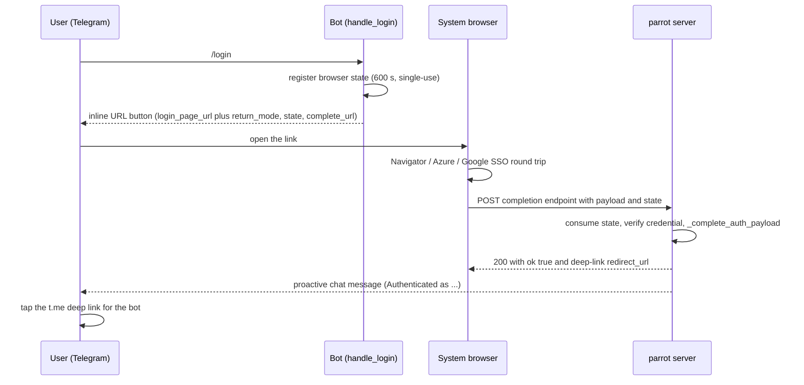

# Telegram Auth Open Mode (webview | browser)

## Purpose

Telegram's login buttons normally open a WebApp inside Telegram. On Linux with
Wayland, Telegram Desktop renders WebApps in its embedded WebKitGTK webview,
which crashes or renders a blank page. Embedded webviews also block WebAuthn /
PassKey logins.

`auth_open_mode` selects how a Telegram bot presents its login:

- `webview` (default) — the login page opens as a WebApp inside Telegram and
  returns its result with `Telegram.WebApp.sendData()`. This is the behaviour
  that existed before FEAT-854, and it is unchanged.
- `browser` — the login button is an inline URL that opens the system browser.
  The browser completes the login against the server, and the bot confirms the
  result in the chat.

Use `browser` for bots whose users sign in from Linux/Wayland desktops or who
need PassKey. The feature is specified in `sdd/specs/telegram-auth-open-mode.spec.md`.

## Public API

The browser-mode code lives in three modules of `ai-parrot-integrations`.

Module `parrot.integrations.telegram.browser_login`:

- `BrowserLoginRegistry` and `BrowserLoginEntry` — in-process map from a
  `browser.` state to the Telegram chat that started the login. Entries expire
  after 600 seconds and are single-use.
- `BrowserIdentityVerifier` — the `Protocol` a server-side identity verifier implements.
- `VerifiedBrowserIdentity` — Pydantic v2 model with `user_id`, `display_name` and
  `email`. It is frozen and forbids extra fields.
- `BrowserVerificationError` — rejected credential or identity; the endpoint returns 401.
- `BrowserVerifierUnavailableError` — verifier or backend could not answer; the endpoint returns 503.
- `register_browser_identity_verifier()` and `get_browser_identity_verifier()` — read and write the verifier map.
- `new_browser_state()`, `is_browser_state()`, `telegram_deep_link()` — state and link helpers.
- `browser_complete_handler()` — the aiohttp handler for the POST completion endpoint.
- `setup_browser_auth_routes(app)` — registers `BROWSER_COMPLETE_PATH` as a POST route
  and adds it to the navigator-auth exclude list. It is idempotent.
- Constants: `BROWSER_COMPLETE_PATH` (`/api/auth/telegram/browser-complete`),
  `BROWSER_STATE_PREFIX` (`browser.`), `BROWSER_LOGIN_APP_KEY`,
  `BROWSER_VERIFIERS_APP_KEY` (`telegram_browser_identity_verifiers`),
  `TELEGRAM_WRAPPERS_APP_KEY`.

Module `parrot.integrations.telegram.browser_verifiers`:

- `NavigatorJWTVerifier` — the default verifier for Navigator session JWTs.
- `ensure_navigator_browser_verifiers()` — at startup, registers the default
  verifier for each page method that lacks one, when signing material is configured.
- `navigator_key_material_configured()` — reports whether `AUTH_SECRET_KEY` or `OAUTH_JWT_KEYS` is set.

Module `parrot.integrations.telegram.oauth2_callback`:

- `oauth2_callback_handler` — the GET handler for the OAuth2 provider redirect.
  It sends `browser.` states to server-side completion and keeps the legacy page for every other state.

Class `TelegramAgentWrapper` (`parrot.integrations.telegram.wrapper`):

- `_setup_browser_mode()` — startup validation. It runs when the wrapper is built.
- `handle_login()` — builds the login keyboard for the active mode.
- `handle_web_app_data()` — the webview `sendData()` entry point.
- `_complete_auth_payload()` — the shared completion pipeline used by webview, the
  browser POST endpoint and the browser OAuth2 callback.

Config model `TelegramAgentConfig` (`parrot.integrations.telegram.models`): fields
`auth_open_mode`, `public_base_url` and `login_page_url`.

## Configuration & Parameters

Set these keys per agent under `agents:` in the Telegram bots YAML.

| Key | Default | Meaning |
|---|---|---|
| `auth_open_mode` | `webview` | `webview` or `browser`. Any other value fails config loading with a `ValueError`. |
| `public_base_url` | unset | Absolute `http(s)` URL of the parrot server, for example `https://parrot.example.com`. Required when `auth_open_mode: browser`; loading fails otherwise. Completion URLs are built from it as `public_base_url` + `/api/auth/telegram/browser-complete`. A trailing slash is stripped. |
| `login_page_url` | unset | The login page that hosts the Navigator, Azure and Google pages. Browser mode uses it exactly as webview mode does. The basic, Azure and Google strategies raise an error if it is missing. |

YAML example (checked by loading it through `TelegramBotsConfig.from_dict`):

```yaml
agents:
  HRAgent:
    chatbot_id: hr_agent
    bot_token: "123456:replace-me"      # or HRAGENT_TELEGRAM_TOKEN
    auth_method: basic
    auth_url: https://navigator.example.com/api/v2/auth/login
    login_page_url: https://login.example.com/login.html   # the login page you host
    auth_open_mode: browser
    public_base_url: https://parrot.example.com
```

Azure, Google and OAuth2 bots use the same two browser keys. Their own settings
(`azure_auth_url`, `google_auth_url`, `oauth2_*`) stay as they were.

### Identity verification

Browser mode never trusts the identity in the browser's JSON. For the page
methods `basic`, `azure` and `google`, the server asks a verifier to prove the
identity from the credential.

- **Registration.** Verifiers live in the app map
  `app["telegram_browser_identity_verifiers"][bot_id][method]`. Here `bot_id` is the
  Telegram bot id that the wrapper resolves at startup. `method` is `basic`,
  `azure` or `google`. `oauth2` is not a page method: the server exchanges the
  OAuth2 code itself through the strategy, so it needs no verifier.
- **Default verifier.** At startup, every page method that has no verifier gets
  `NavigatorJWTVerifier(tenant_id=<bot tenant>)`. This happens only when
  `AUTH_SECRET_KEY` (navconfig) or `OAUTH_JWT_KEYS` (navigator-auth) is set. The
  signing material must match the Navigator issuer's.
- **Startup error.** If a page method still has no verifier after that step, the
  wrapper raises `ValueError` while it is built. The error reads
  `browser mode requires identity verifiers for: <methods>`. The bot does not start.
  Failing at startup avoids a failure at login time.

The verifier contract is one coroutine:

```python
async def verify(self, token: str, *, auth_method: str, bot_id: str, tenant_id: str | None) -> VerifiedBrowserIdentity
```

It must raise `BrowserVerificationError` (HTTP 401) for a rejected credential, or
`BrowserVerifierUnavailableError` (HTTP 503) when its backend is down. Any other
exception is logged and turned into a 503. After verification, any `user_id`,
`display_name` or `email` the browser supplies must match the verified identity.
Otherwise the request gets a 401.

`NavigatorJWTVerifier` checks, in this order:

1. The credential is non-empty. The header is read from the part after an optional `<tenant>:` prefix.
2. The JWT header `alg` is one of `HS256`, `HS384`, `HS512`, `RS256`, `ES256`.
3. navigator-auth's `IdentityProvider.decode_token` verifies the signature and
   expiry. It checks the issuer against the configured issuer, or against
   navigator-auth's `AUTH_TOKEN_ISSUER` when none is configured. Failures are 401,
   and an unavailable provider is 503.
4. The claims are a dict, carry no `aud` claim, and include a `user_id`.
5. If the token carries a tenant, it must equal the bound tenant (the verifier's
   `tenant_id` or the bot's `tenant`). A token without a tenant passes this check.
6. The `auth_method` claim must equal `azure` or `google` for those methods. For
   `basic` it must be absent or `basic`.

It returns `user_id`, `name` as `display_name` and `email`. Basic logins carry no
name or email unless the token has those claims.

### Browser state

- A state is `browser.` followed by 32 random bytes encoded as URL-safe base64
  (43 characters).
- Each state is single-use and expires after 600 seconds.
- The completion endpoint never accepts a state without the `browser.` prefix.
  Such a state gets 410.

## Usage Examples

### Wiring a custom verifier

Register your verifier before the bot starts. The `bot_id` must be the Telegram
bot id as a string. The `verify` body below is a placeholder for your own check.

```python
from parrot.integrations.telegram.browser_login import (
    BrowserVerificationError,
    VerifiedBrowserIdentity,
    register_browser_identity_verifier,
)


class MyTokenVerifier:
    async def verify(self, token, *, auth_method, bot_id, tenant_id):
        claims = await my_issuer_check(token)  # placeholder: your own signature/expiry check
        if claims is None:
            raise BrowserVerificationError("invalid token")
        return VerifiedBrowserIdentity(user_id=str(claims["sub"]), display_name=claims.get("name"))


register_browser_identity_verifier(
    app, bot_id="7001", auth_method="basic", verifier=MyTokenVerifier()
)
```

With `IntegrationBotManager`, the completion route is mounted for every browser-mode
bot automatically. A standalone bot must share the aiohttp app that serves the
endpoint, as described in the Gotchas below.

### Flow: webview (unchanged)

```text
/login -> WebApp button (login_page_url?...) -> login page
       -> Telegram.WebApp.sendData(payload) -> handle_web_app_data
       -> _complete_auth_payload -> chat confirmation
```

### Flow: browser, page-based login (basic, Azure, Google)



### Flow: browser, OAuth2

The inline button opens the provider's authorize URL directly, with PKCE. The
provider redirects to `oauth2_redirect_uri`, and that URL must reach
`oauth2_callback_handler` over GET. Nothing in this repository mounts that
handler: `setup_oauth2_routes` in `parrot.integrations.telegram.oauth2_callback`
adds it at `/oauth2/callback` by default, but no caller in the repo invokes it, so
the deployment mounts it. The handler then exchanges the code server-side through
`_complete_auth_payload` and shows the success page. The chat confirmation follows
the same path as the page-based flow. Routing is by state: a `browser.` state takes
the server-side branch, and any other state keeps the legacy page.

### Browser state routing and status codes

Completion endpoint (`POST /api/auth/telegram/browser-complete`, JSON body):

| Status | `error` | When |
|---|---|---|
| 200 | — | Success. Body `{"ok": true, "redirect_url": "https://t.me/<bot>"}`. `redirect_url` is `null` when the bot has no valid username. |
| 400 | `bad_request` | Malformed JSON, a non-object body, or a missing `state`. |
| 401 | `rejected` | Unknown `auth_method` value, a missing or invalid credential, an identity mismatch, a method the bot does not enable, or a completion that returns false. |
| 410 | `expired` | Unknown, expired or already-used state, or a state without the `browser.` prefix. |
| 503 | `unavailable` | The verifier is unavailable, or no wrapper is registered for the state's bot. |

OAuth2 provider redirect (`GET /oauth2/callback` with a `browser.` state). The response is an HTML page:

| Status | When |
|---|---|
| 200 | Success page with a `https://t.me/<bot>` deep link. |
| 400 | The provider reported an error or cancelled, or sent no `code`. The state is consumed. |
| 401 | The verifier or code exchange rejected the sign-in. |
| 410 | Unknown, expired or already-used state. |
| 503 | The bot or its verifier is unavailable. |

A state without the `browser.` prefix on the GET callback keeps the legacy page.
No token or claim is echoed back in any response body.

### Login pages and return context

The shipped pages are `login.html`, `login_multi.html` and `azure_login.html`,
under the Telegram `static/` directory of the integration. In browser mode the
inline button points at the login page with three query parameters:

- `return_mode=browser`
- `state` — the exact `browser.` state
- `complete_url` — the server-derived completion URL

The pages keep this context across the Azure or Google SSO round trip. They store
a marker in `sessionStorage` under `tg_browser_login_ctx`, and they restore it
before they handle the returning `?token=`. When the context is present, the page
POSTs `{...payload, state}` to `complete_url` instead of calling `sendData()`.

The pages fail closed. A `return_mode` other than `browser`, a malformed state, a
state that differs from the stored marker, or a `complete_url` that is not on
`/api/auth/telegram/browser-complete` with no query or hash all show an error. They
never POST, and they never fall back to `sendData()`. Pages opened with no browser
parameters behave as before.

A `complete_url` on another origin must be listed by the deployer in the
`parrot-browser-complete-origins` meta tag. The shipped pages contain
`<meta name="parrot-browser-complete-origins" content="">`. Set `content` to a
space-separated list of origins, for example
`content="https://api.example.com"`, when the pages are hosted on a different origin
from the completion endpoint. The page's own origin is always allowed.

## Gotchas

- **Single-process registry.** `BrowserLoginRegistry` and the OAuth2 `_pending_states`
  are in-memory. Under multiple gunicorn workers the callback can land in a worker
  that does not hold the state, and it gets 410. Run browser-mode bots in one
  process. Redis-backed state is a follow-up.
- **Shared aiohttp app.** The completion endpoint and the bot must run in the same
  aiohttp application. `_setup_browser_mode()` raises `ValueError` at startup when
  the wrapper has no app, so a standalone bot cannot use browser mode.
- **Verifier errors show at startup, not at login.** A page method with no verifier
  stops the bot at construction. See *Identity verification*.
- **Navigator `AUTH_TRUSTED_DOMAINS`.** After a login, navigator-auth honours a
  `redirect_uri` only if it is a relative path, a host listed in
  `AUTH_TRUSTED_DOMAINS`, or a mobile deep-link scheme. Otherwise it falls back to
  `AUTH_REDIRECT_URI`. For the Azure return to reach the login page, the login-page
  host must be in `AUTH_TRUSTED_DOMAINS`.
- **Google browser SSO needs a navigator-auth fix.** navigator-auth's Google backend
  builds `redirect_uri` from the request (`get_redirect_uri(request)`). It does not
  keep the caller's `redirect_uri`. So `return_mode`, `state` and `complete_url` are
  lost on the Google round trip, and Google browser login cannot complete until
  navigator-auth is fixed.
- **No display name or email on basic logins.** A basic browser login has no display
  name or email unless the verified token carries `name` or `email` claims. The
  success page then renders an empty name.
- **The inline button stays in the chat history.** Browser mode does not remove
  the login button. The success message is a new chat message.
- **Keep `complete_url` and `redirect_url` server-derived.** Both are built from
  `public_base_url` and fixed paths. Never take them from client input. The pages
  validate `complete_url` for this reason.

## Related

- [Google OAuth 2.0 integration](google-oauth2.md) — the OAuth2 provider setup that `auth_method: oauth2` uses.
- [Telegram connections](telegram-connections.md) — the delegated connections a linked Telegram user can use after login.
- [Telegram Bot Integration Guide](telegram_integration.md) — the bot YAML and setup that these keys sit in.
- Specification: `sdd/specs/telegram-auth-open-mode.spec.md` (FEAT-854).
- Follow-ups from the spec: PassKey / WebAuthn login through navigator-auth; OAuth2
  for MCP tools; Redis-backed browser-login state; profile enrichment through
  navigator-auth's `GET /api/v1/user/session`, which exists in navigator-auth and is not yet used by parrot.
